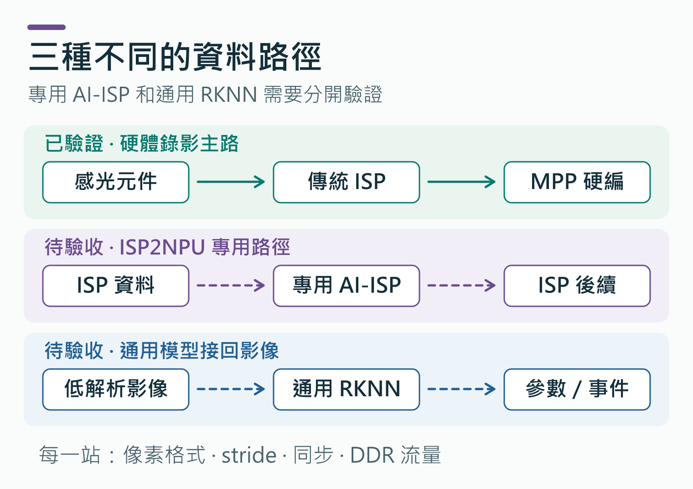
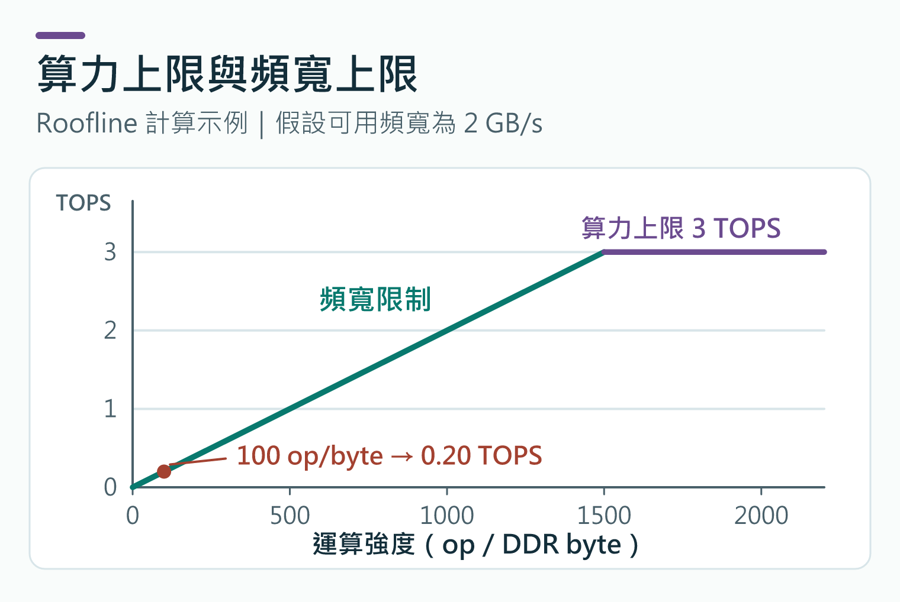

同一個模型跑得很快，相機預覽依然可能掉幀。感光元件、ISP、RGA、NPU 和編碼器都有各自的佇列與緩衝區；一幀影像可以在等待、轉格式、搬資料或同步時消耗掉大部分預算。**一張 4K NV12 影像約 12.44 MB，30 fps 時多一次全幀讀寫就約 746.5 MB/s**。這筆流量與模型算了幾次乘加無關。

這篇從像素和記憶體成本出發，說清傳統 ISP、專用 AI-ISP 和標準 RKNN 模型分支各適合做什麼，再用 RV1126B 的實板輸入對照設計整機量測。

{/* truncate */}

<figure className="camera-lab-figure">
  
  <figcaption>圖 1｜三條資料路徑示意。實線是本實板已驗證的 ISP 硬編主鏈，虛線是待驗收的接法。每個箭頭都需確認格式、步長、同步和 DDR 往返。</figcaption>
</figure>

## 同一幀 RAW、YUV 與模型張量看見什麼

感光元件的 Bayer RAW 每個像素只量到一個色彩分量，常保留較接近線性的亮度，噪聲也與訊號強度相關。ISP 通常要經過黑位、壞點與鏡頭陰影校正、類比／數位增益、去馬賽克、降噪、AWB、CCM、色調曲線和輸出色彩格式轉換，確切先後視 ISP 架構而定。早期做降噪可以用單通道的噪聲模型和時間歷史；晚期影像可直接看見使用者所見的色彩及對比，部分高光與暗部訊息可能已被色調映射或裁切。

NV12 是 8-bit YUV 4:2:0 的雙平面格式，一個像素有一個 Y 樣本，每 2×2 像素共用一對 UV 樣本。把 NV12 送入 RGB 模型，還要核對量化範圍、色彩矩陣（如 BT.709）、UV 順序、實際 stride、縮放濾波和張量佈局。直接把 YUV 記憶體解讀為 RGB 張量會產生錯色。經裁切或 letterbox 的模型若回傳位置，還需將座標按同一幀的縮放、裁切和 EIS 網格映回顯示。 [Linux NV12 等像素格式](https://docs.kernel.org/userspace-api/media/v4l/pixfmt-yuv-planar.html) · [Rockchip RGA 官方介面](https://github.com/airockchip/librga)

| 路徑 | 適合做什麼 | 品質／資源代價 |
| --- | --- | --- |
| 傳統 ISP + 硬編 | 黑位、色彩、鏡頭陰影、3A、時域降噪，穩定錄影 | 依賴 IQ 和噪聲標定。應作為每次 A/B 的基線 |
| 專用 ISP2NPU／AI-ISP | 在 BSP 指定的 ISP 資料路徑內做相容的降噪或畫質模型 | 受資料結構、算子、模型與感光元件模式限制 |
| 通用 RKNN 分支 | 手勢、偵測、分割或低解析色彩參數估計 | 需考慮轉格式、排程和是否把輸出用回同幀 |
| 全解析後處理 | 用 NEON 或平台支援的運算單元套 LUT、局部顏色變換，或較大的增強模型 | 算子可控、調試較直觀。每次全幀出入都要驗證頻寬和延遲 |

公開 RV1126B 資料手冊列出的 AI-ISP 規格為**最高 8 MP@30 fps**，並描述 ISP2NPU 的 BAY3D 資料路徑與專用算子限制。8 MP 是規格級描述，實際可用的幅寬、幀率、RAW 模式及錄影並行條件仍須按同版 BSP 範例對照。公開描述可見 DDR 存取，是否減少拷貝要從實測資料流判斷。板上已枚舉到 rkaiisp，也能看到 RKAIQ 的 initAiisp 與讀回類接口；模型相容、輸出生效和畫質還需做各自的驗證。 [Rockchip RV1126B 資料手冊](https://opensource.rock-chips.com/images/8/82/Rockchip_RV1126B_Datasheet_V1.4-20250930_%28public%29.pdf)

## 算力為什麼兌換不成幀率

理想儲存尺寸可用下式估算。$$W,H$$ 為有效寬高，$$F$$ 是每秒幀數，$$n$$ 是額外全幀讀寫次數；數值以十進制 MB 計。

$$
S_\mathrm{NV12}=1.5\,WH,\qquad B_\mathrm{rw}=2n\,S_\mathrm{NV12}F
$$

| 解析度／30 fps | 一幀大小 | 額外一次全幀讀加寫 |
| --- | ---: | ---: |
| 1920×1080 | 3.11 MB | 186.62 MB/s |
| 2560×1440 | 5.53 MB | 331.78 MB/s |
| 3840×2160 | 12.44 MB | 746.50 MB/s |

還要計入 stride、填充、RAW、模型激活與權重、編碼器參考畫面、顯示和其他裝置的併發。壓縮、片上緩存與融合算子也會改變真正流過 DDR 的量。表格可用來估上層流程的資料需求。量真實帶寬時，要拿 SoC 可讀到的記憶體計數器或同負載對照，並記錄 DDR／NPU 頻率和溫度。 [頻寬估算 CSV](/research/rv1126b-camera/nv12-bandwidth.csv) · [C++ 計算工具](/research/rv1126b-camera/camera-lab.cpp)

以 Roofline 的觀點，運算上限由硬體峰值與 DDR 頻寬共同限制。$$I$$ 是每讀寫一個 DDR byte 能做多少次 operation，$$B_\mathrm{eff}$$ 是可用帶寬，則可達運算率的上界為：

$$
P_\mathrm{eff}\leq\min(P_\mathrm{peak},\,B_\mathrm{eff}I)
$$

例如假設有效帶寬 **2 GB/s**、運算強度 **100 op/byte**，頻寬只能供給 **0.20 TOPS**，縱使算力峰值為 3 TOPS。這組帶寬與強度純供計算。運算量比較時，需統一乘加是計 1 MAC 還是 2 ops，並用有效層、張量形狀和精度來核對。模型之外還要看端到端延遲：流水線吞吐可由最慢階段限制，同一幀的等待時間依然會沿階段累加。30 fps 約每 33.3 ms 進一幀，落後時若一直排隊，幀率數字可能看起來正常，手機看到的畫面卻越來越舊。 [Williams 等人的 Roofline 模型](https://escholarship.org/uc/item/5tz795vq)

<figure className="camera-lab-figure">
  
  <figcaption>圖 2｜Roofline 計算示例。假設頻寬為 2 GB/s、算力上限為 3 TOPS，交會點為 1,500 op/byte。圖中的數值未用 RV1126B 的 DDR 計數器驗證。</figcaption>
</figure>

## 零拷貝、INT8 與低解析網格的取捨

**零拷貝要沿整條路徑查。** DMA-BUF 可讓多個硬體使用同一底層緩衝區，並確認生產者完成後消費者才讀取。緩衝區格式、對齊、位址域、擁有權及同步都要相容。CPU mmap 後需要遵守快取同步規則，DMA fence 管的是裝置工作完成時序。描述符相同只能說明有共享；色彩轉換、CPU 落地、張量重排與空間縮放都可能再生出資料。即使省掉 CPU memcpy，各硬體仍可能各自讀 DDR。 [Linux DMA-BUF 與同步](https://docs.kernel.org/driver-api/dma-buf.html) · [Rockchip RKNN C API](https://github.com/airockchip/rknn_model_zoo/blob/main/3rdparty/rknpu2/include/rknn_api.h)

**INT8 把連續訊號映到有限格點。** 用比例 $$s>0$$ 與零點 $$z$$，8 位有符號 affine 量化可寫成下式。量化區間裡的理想捨入誤差不超過 $$s/2$$，超出區間會裁切。

$$
q=\mathrm{clip}\!\left(\mathrm{round}(x/s)+z,-128,127\right),
\qquad \hat x=s(q-z)
$$

若校正資料以明亮陸地為主，水下暗紅訊號可能落入很少的量化格，容易出現色階斷裂或弱紋理消失。PTQ 先以水質、照度、燈光、色卡、移動與顆粒分層取代表樣本，再在不同的留出素材上量精度、色差、暗部階調與時序閃動。用支援的逐通道權重量化或混合精度救明顯失真的層，仍不夠再考慮 QAT。以板上模型編譯報告和效果輸出確認算子、精度和資料域。 [Jacob 等人的整數量化推理](https://openaccess.thecvf.com/content_cvpr_2018/html/Jacob_Quantization_and_Training_CVPR_2018_paper.html)

**讓模型輸出參數可以降低成本。** 若全圖 3840×2160 先縮成 320×180，兩者像素數相差 144 倍。這個比例只描述輸入像素數，不能直接換算模型加速比。低解析 CNN 可估全局 3D LUT、局部雙邊網格或每區增強強度，高解析只做插值和套用。若場景緩慢變化，還可低頻更新參數，主影像保持每幀編碼，並用時間平滑控制色閃。對快速燈光與水下顆粒，要驗證延遲、局部光暈等問題。影像品質允許時，先以 ISP 內的參數達到目標；再比較全幀 LUT、低解析模型與全解析增強。 [HDRNet 的低解析估計與高解析套用](https://groups.csail.mit.edu/graphics/hdrnet/)

## 實板 A/B｜綁定之後還有哪些成本

<figure className="camera-lab-figure">
  
  <figcaption>圖 3｜RV1126B 實板上的通用 RKNN A/B。計時從提交輸入到讀出模型結果，每組 60 筆。</figcaption>
</figure>

兩條路徑使用同一個 416×416 的 INT8 YOLO11n、兩張交替的輸入圖，每組預熱 5 次再量 60 次。兩張圖的輸出張量校驗值一致。原生格式直傳的輸入提交 p50 為 0.425 ms，綁定加 CPU 寫入與同步為 0.385 ms。然而總耗時 p95 從 **17.301 ms** 變成 **18.693 ms**。這次差異有待以交錯、長時間的多輪測試確認。結果只涵蓋這個模型的兩種通用輸入路徑，另有硬體生產的 DMA-BUF 路徑和專用 AI-ISP 可驗證。 [彙總 CSV](/research/rv1126b-camera/rknn-input.csv) · [可選的 C 探針](/research/rv1126b-camera/rknn-bound-input.c)

## 實驗｜如何證明整台相機變快、變清楚

| 實驗階段 | 對照設計 | 要交出的證據 |
| --- | --- | --- |
| 硬體基線 | 同一解析度、IQ、曝光、碼率。先只錄影，再加手機預覽 | 感光元件序號和 PTS、輸出 fps、p95/p99 幀間隔、掉幀和熱穩態 |
| 輸入交接 | 交錯跑原生直傳、綁定加 CPU 寫入、硬體生產相容緩衝區三組 | 顏色和張量結果一致性；轉換、同步、提交、推理、讀回和端到端的耗時 |
| 專用 AI-ISP | 找同版 BSP 原廠模型，先做支援的 1080p 開關對照，再上更高解析度 | 每幀生效標誌、驅動模式與緩衝區生命週期；定曝光的暗部噪聲、邊緣拖尾和細紋 |
| 水下增強 | 同一原片比較 ISP-only、低解析 LUT／雙邊網格、受支援的其他模型 | 色卡 ΔE₀₀、紅暗部 SNR、時間方向閃爍、局部光暈，並記每幀成本 |
| 並行和降級 | 硬編、手機預覽和業務推理併行，跑到溫度穩定，再觸發壓力場景 | 階段佇列長度、最舊畫面年齡、功耗、頻率與掉幀；停用增強時錄影是否連續 |

跨階段應使用同一時基和幀序號。量手機取景延遲時，可用高速參考相機同時拍攝閃爍計時器和手機螢幕，避免把網路、解碼和顯示的延遲漏掉。主錄影使用自己的有限佇列和資源優先級，業務推理可採最新幀、按置信度或負載調頻。若模型結果跨幀，需明確記錄來源序號和適用時間。壓測應報告樣本數、暖機條件和分場景失敗率；p99 需要足夠樣本支撐，60 次輸入對照只適合當初步參考。

目前已證實 IMX415 → ISP → MPP 硬編，以及通用 RKNN 的兩條輸入路徑。下一個里程碑是拿到**同版原廠 AI-ISP 模型與板上開關對照**，確認畫質分數、延遲、幀率與功耗同時達標，再決定是否接入即時水下增強。

延伸閱讀 [水下光路與色彩](/blog/rv1126b-underwater-color) · [曝光 HDR 與時域降噪](/blog/rv1126b-motion-isp)
