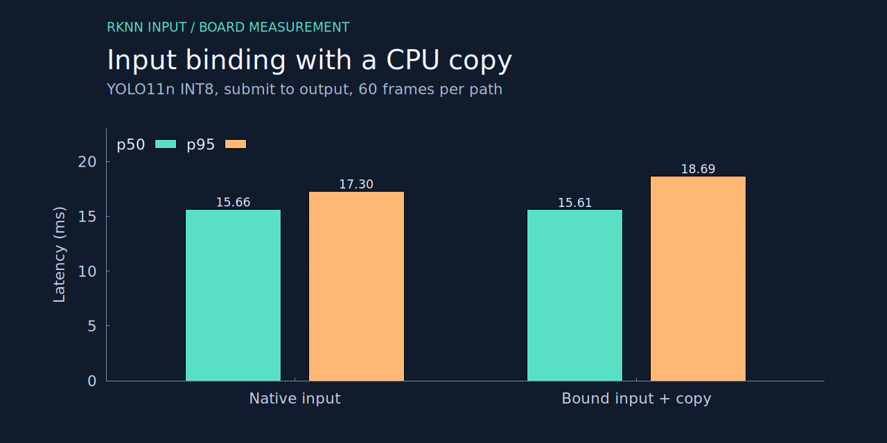

RV1126B 能做 ISP、硬體 H.264 和板端 RKNN 推理。要把水下增強放進整條視訊路徑，應先量每個緩衝區由誰產生、被誰讀取、在哪裡跨過 DDR。4K30 每幀多做一次全幀讀寫，理想估算已是 **約 746 MB/s**。這篇用實板 RKNN 對照與解析度估算建立選路基線。

{/* truncate */}

<figure className="camera-lab-figure">
  
  <figcaption>實板 RKNN 輸入 A/B。計時從提交輸入到模型結果讀出，每組 60 幀。</figcaption>
</figure>

## 一次綁定記憶體 A/B

用同一個 416×416 INT8 YOLO11n 和兩張交替測試圖。每種輸入預熱 5 幀，再測 60 幀。兩張圖的輸出張量校驗值一致。

| 方法 | 輸入提交 p50 / p95 | 提交至結果讀出 p50 / p95 |
| --- | ---: | ---: |
| 原生格式直傳 `rknn_inputs_set` | 0.425 / 0.613 ms | 15.663 / 17.301 ms |
| 綁定輸入 `rknn_set_io_mem` + CPU 寫入與同步 | 0.385 / 0.542 ms | 15.610 / 18.693 ms |

這輪涵蓋一個模型與兩張圖。綁定之後仍要寫入和同步，觀察到的總耗時 p95 高了 **1.392 ms**。下一組 A/B 應使用由 ISP 或 RGA 直接產生的相容緩衝區，計入圖像轉換、快取同步、NPU 執行與讀出。 [Rockchip RKNN C/C++ Runtime](https://github.com/airockchip/rknn-toolkit2)

[實測彙總 CSV](/research/rv1126b-camera/rknn-input.csv) · [板端 C 探針](/research/rv1126b-camera/rknn-bound-input.c)。探針需要對應版本的 `rknn_api.h`、`librknnrt`、416×416 原生 INT8 NHWC 模型和兩張二進位 RGB PPM。

## 先算資料，再選處理器

未壓縮 NV12 每幀按 `寬 × 高 × 1.5 byte` 估算。下面計算一次全幀讀與一次全幀寫，未計入步長填充、多緩衝區或仲裁。可用 [C++ 實驗程式](/research/rv1126b-camera/camera-lab.cpp) 和 [CSV](/research/rv1126b-camera/nv12-bandwidth.csv) 重算。

| 解析度 / 30 fps | 每幀 | 一次讀加一次寫 |
| --- | ---: | ---: |
| 1920×1080 | 3.11 MB | 186.62 MB/s |
| 2560×1440 | 5.53 MB | 331.78 MB/s |
| 3840×2160 | 12.44 MB | 746.50 MB/s |

即時去散射可以先在低解析度用 NPU 預測色彩轉換或雙邊網格。全解析應用仍會讀取輸入並生成輸出，需要比較 ISP、GPU 或原生 NEON 的讀寫成本與品質。

## 實際的 AI-ISP 驗證路線

實板已枚舉 `rkaiisp`，RKAIQ 頭文件暴露 `rk_aiq_uapi2_sysctl_initAiisp`、`ReadAiisp` 以及緩衝區和完成事件的相關定義。晶片資料給出 AI-ISP 最高 **8 MP @ 30 fps**、特定的算子與層數限制，以及 ISP2NPU 對 BAY3D 資料的 DDR 路徑。通用 RKNN 與專用 AI-ISP 有各自的模型相容性。 [Rockchip RV1126B 資料手冊](https://opensource.rock-chips.com/images/8/82/Rockchip_RV1126B_Datasheet_V1.4-20250930_%28public%29.pdf)

1. **原廠參考模型。** 找到與這版 BSP 對應的權重、支援模式和示例。用固定的 1080p 場景做開關 A/B，讀回每幀生效標記。
2. **核對緩衝區。** 實測像素格式、張量步長、檔案描述元和同步，確認資料通過哪個硬體單元。記錄各階段 p50/p95/p99、掉幀、DDR 讀寫、溫度與功耗。
3. **測畫質和並行裕量。** 以低光、快速運動邊緣和補光掃過的場景比較噪聲與拖尾。加上 MPP 編碼與手機取景，再開啟一個業務模型，觀察熱穩態。
4. **確認自訂模型入口。** 用極小模型核對輸入輸出和支援算子，再決定水下增強的執行路徑。

已驗證的產品路徑是 IMX415 → ISP → MPP 硬編，以及通用 RKNN 推理。AI-ISP 啟用的畫質和性能、這塊板的 4K 水下端到端路徑，都還有各自的驗收工作。

延伸閱讀 [MS5837 與水下色彩](/blog/rv1126b-underwater-color) · [運動 ISP 的曝光與降噪](/blog/rv1126b-motion-isp)
