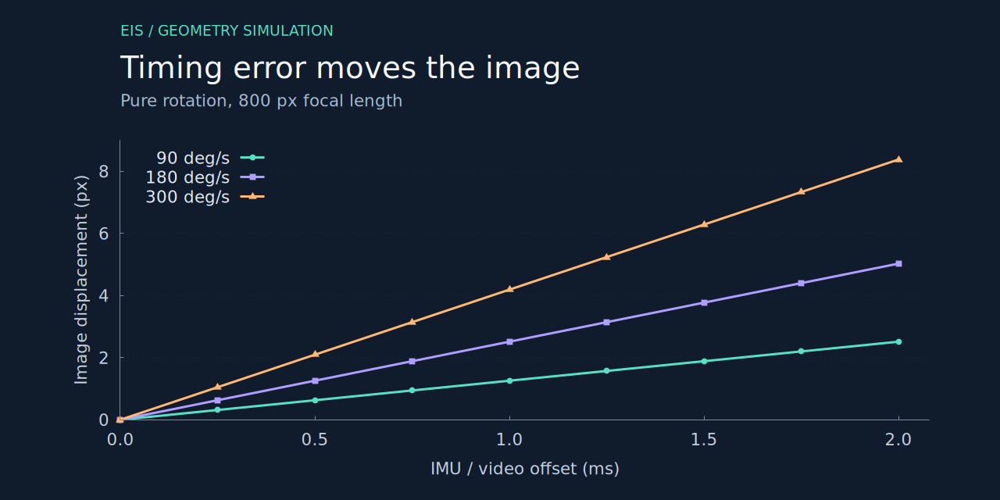

import CameraTimingCalculator from '@site/src/components/CameraTimingCalculator';

手持相機快速轉動時，陀螺儀如果晚了 1 ms，即使姿態濾波器算得很準，畫面也會補錯方向。以 800 像素焦距、300°/s 角速度估算，畫面中心已偏了 **4.19 像素**。這一篇從可重做的數值實驗開始，把同步、逐行讀出和機內網格映射串起來。

{/* truncate */}

<figure className="camera-lab-figure">
  
  <figcaption>幾何模擬。假設焦距 800 px、純旋轉，曲線表示畫面中心位移。</figcaption>
</figure>

## 為什麼先量時間

把畫面中心投影簡化為 `位移 = f × tan(ω × Δt)`，可分別改變角速度與時間偏移。[C++ 實驗程式](/research/rv1126b-camera/camera-lab.cpp) 和 [數值 CSV](/research/rv1126b-camera/eis-offset.csv) 可以重跑。

```sh
c++ -std=c++17 -O2 camera-lab.cpp -o camera-lab
./camera-lab eis
```

| 角速度 | 0.25 ms | 1 ms | 2 ms |
| ---: | ---: | ---: | ---: |
| 90°/s | 0.31 px | 1.26 px | 2.51 px |
| 180°/s | 0.63 px | 2.51 px | 5.03 px |
| 300°/s | 1.05 px | 4.19 px | 8.38 px |

<CameraTimingCalculator />

RV1126B 實板另外做過兩條 ISP 輸出對時，1080p 下 67 筆 AI 取樣時間對最近視訊 PTS 的 p95 差值是 **0.089 ms**。接上 IMU 後仍需實測陀螺儀與感光元件曝光的相位。Linux V4L2 緩衝區有時間戳來源旗標，採集時應確認驅動給的是曝光開始或畫面結束。 [Linux V4L2 緩衝區](https://www.kernel.org/doc/html/latest/userspace-api/media/v4l/buffer.html)

## 做一份能重複開啟的 Gyroflow 專案

1. 將六軸 IMU 剛性固定於相機。以 SPI、FIFO 和資料就緒中斷起步，先試 800–1000 Hz，保存每筆樣本時間及掉樣記錄。用同一單調時鐘關聯影像序號和採集時間。IMU 有獨立計時器時，用多個觀測點擬合時鐘比例與偏移。
2. 同時保留原片、`.gcsv`、逐幀時序表和鏡頭參數。核對陀螺儀軸向及比例。拍棋盤格覆蓋中心、四邊和四角，依鏡頭、裁切和防水殼配置保存內參。裝殼入水後另做一次標定。
3. 用固定頻率 LED 條紋量逐行讀出時間和方向。再拍快速左右擺動，用多個同步點估計影片與 IMU 的偏移與漂移。把偏移、讀出時間、鏡頭校準分開保存，另用一段影片驗收。

[GCSV 格式](https://docs.gyroflow.xyz/app/technical-details/gcsv-format) · [鏡頭校準](https://docs.gyroflow.xyz/app/getting-started/lens-calibration) · [同步方法](https://docs.gyroflow.xyz/app/getting-started/basic-usage/synchronization) · [LED 讀出時間實驗](https://github.com/gyroflow/rollingshutter)

## 從離線結果走到 FEC

機內以陀螺儀積分四元數，配合可信的加速度估計重力方向。用平滑後的姿態定義虛擬相機，對輸出像素反推來源光線。逐行補償時按該行曝光中心取姿態，把畸變、旋轉和裁切合成一張網格。先用 CPU 測試恆等、平移與旋轉，再核對 FEC 的網格順序、像素格式、緩衝區交接和切換生效幀。AI 疊加也需使用同一幀的映射。

這塊 K12S-C 可讀到 `rk_aiq_uapi2_sysctl_regMemsSensorIntf`。目前找到的 `afec_SetAttrib` 結構只包括啟用、模式、旁路、強度和方向。逐幀提交自訂網格仍需用 BSP 或廠商示例確認。板上尚未枚舉到 IMU，實拍離線防抖與機內 EIS 待驗證。 [Rockchip RV1126B 資料手冊](https://opensource.rock-chips.com/images/8/82/Rockchip_RV1126B_Datasheet_V1.4-20250930_%28public%29.pdf)

**第一個驗收物**是一段關閉防抖的 1080p30 原片，加上同錄的陀螺儀日誌與標定檔。用另一段快轉影片比對校正前後的垂直線傾斜、地平線誤差、裁切率和時間偏移。確認離線輸出可重現，再量 FEC 的 p95/p99 端到端延遲。

延伸閱讀 [運動 ISP 的曝光與降噪](/blog/rv1126b-motion-isp) · [AI-ISP 與記憶體頻寬](/blog/rv1126b-ai-isp)
