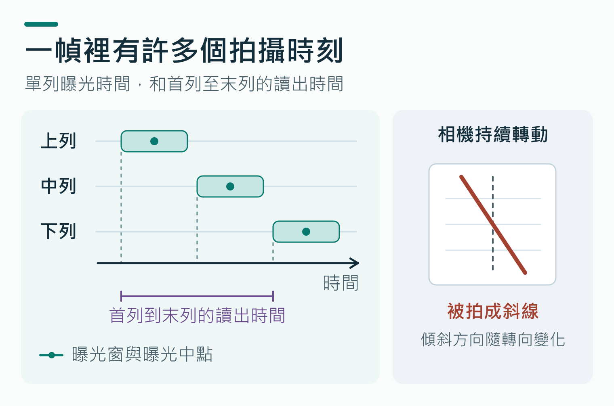

import CameraTimingCalculator from '@site/src/components/CameraTimingCalculator';

同一段運動影片可以同時出現三種問題：整個畫面跟著手抖、垂直線在畫面內歪斜，以及輪廓被拖成一條帶。第一種來自幀與幀之間的視角改變，第二種來自同一幀各列的拍攝時間差，第三種則發生在單列曝光期間。三者都受運動影響，卻需要不同的測量和處理。

以焦距 800 px、轉速 300°/s 為例，**只差 1 ms 就可能讓畫面中心偏 4.19 px**。這個量級說明，機內防抖得先把 IMU、感光元件和錄影畫面的時間關係量清楚。

{/* truncate */}

<figure className="camera-lab-figure">
  
  <figcaption>圖 1｜逐列曝光示意。每列都有自己的曝光中點。圖中方向與間距供理解，實際讀出順序需按感光元件模式測量。</figcaption>
</figure>

## 抖動、果凍和模糊的物理來源

把相機暫時視為針孔，三維點在相機座標中為 $$(X,Y,Z)$$，其水平像素座標為 $$u=f_x X/Z+c_x$$。其中 $$f_x$$ 以像素為單位，$$c_x$$ 是主點。相機繞垂直軸小角度轉動時，畫面中心的水平位移量由下式近似。

$$
|\Delta u| = f_x |\tan(\omega\,\Delta t)|
           \approx f_x |\omega\,\Delta t|
$$

$$\omega$$ 要用 rad/s，$$\Delta t$$ 用秒。等式適用於中心附近的純旋轉，廣角邊緣還需使用鏡頭投影與畸變模型。若相機平移 $$\Delta X$$，一階像移約為 $$f_x|\Delta X|/Z$$，近物移得比遠景多。這種**視差**解釋了為什麼同一張全局單應矩陣在近距離礁石與遠處背景同時入鏡時會失準。

逐列曝光可用一個時間模型描述。令 $$t_0$$ 為首列曝光起點，$$T_\mathrm{read}$$ 為首列至末列的曝光起點時間差，$$H$$ 為有效影像高度，$$T_\mathrm{exp}$$ 為每列的曝光時間。

$$
t_\mathrm{mid}(y)=t_0+\frac{y}{H-1}T_\mathrm{read}
                    +\frac{T_\mathrm{exp}}{2}
$$

上式假設由上往下等間距讀出。由下往上用 $$H-1-y$$，裁切、翻轉及特殊讀出模式要保留原列座標與順序。$$T_\mathrm{read}$$ 決定同幀各列的視角差，$$T_\mathrm{exp}$$ 決定每列光線積分時有多少像移，幀週期則決定相鄰影像的取樣間隔。假設轉速 180°/s、讀出 12 ms、曝光 1/240 s、焦距 800 px，讀出造成的上下端像移差約 **30.2 px**，曝光期間的中心像移約 **10.5 px**。前者可在幾何上重映射，後者已在曝光時混合了不同方向的光線。反卷積最多在有足夠訊噪比和已知模糊核時救回一部分細節。 [Karpenko 等人的陀螺儀防抖與逐行校正](https://graphics.stanford.edu/papers/stabilization/)

## 同步誤差怎麼量

把 IMU 的本地時鐘轉到相機的單調時基，可先擬合 $$t_\mathrm{cam}=a\,t_\mathrm{imu}+b$$。$$b$$ 包含時基偏移，$$a$$ 描述頻率差。50 ppm 的未補償頻率誤差，在十分鐘後會累積成 30 ms。若記錄的是 FIFO 批次被軟體讀取的時間，批次內各筆樣本還會共享一個偏晚的時間標籤。應以感測器硬體計時器或資料就緒時刻重建各筆時間，保存序號、插值或掉樣標記。

| 要分開量的量 | 用什麼量 | 失準時的表現 |
| --- | --- | --- |
| 固定偏移與時鐘漂移 | 起、中、末段分別用角速度與畫面運動對時 | 短片看似良好，長片越來越抖 |
| 畫面讀出時間與方向 | 已知頻率、佔空比的 LED 及方向標記 | 中央看似穩定，直線上、下端仍扭曲 |
| IMU 至鏡頭的軸向與零偏 | 靜止熱機，逐一繞三軸正反轉 | 補錯軸、姿態慢慢飄、倒置後反向 |
| 幀時間戳的語義 | 查驅動、用光學事件與硬體訊號交叉核對 | ISP/編碼延遲被誤當成曝光時間 |

V4L2 有 SOE（開始曝光）和 EOF（幀結束）等來源語義。應查當前驅動實際填入的標誌，並驗證幀開始訊號與光學變化的關係。編碼 PTS 可用來關聯輸出，還需要保留其與採集序號和曝光時間的對應。已有 RV1126B 基線為 1080p 的 **67 筆 AI 取樣時間對最近視訊 PTS，p95 差值 0.089 ms**，這組數字只描述兩條已有輸出的相對時間關係。 [Linux V4L2 緩衝區與時間戳](https://www.kernel.org/doc/html/latest/userspace-api/media/v4l/buffer.html)

<figure className="camera-lab-figure">
  
  <figcaption>圖 2｜中心位移的幾何計算，假設焦距 800 px、純旋轉。若在此條件下把中心殘差限制為 1 px，300°/s 時對時誤差應在約 0.24 ms 內。</figcaption>
</figure>

<CameraTimingCalculator />

[計算結果 CSV](/research/rv1126b-camera/eis-offset.csv) · [可重算的 C++ 小工具](/research/rv1126b-camera/camera-lab.cpp)

## 估姿態、做平滑、最後重投影

### 陀螺儀和其他方法各自提供什麼

陀螺儀量到的是角速度。先扣除零偏，將 IMU 軸轉換到相機座標，以相鄰時間樣本的平均角速度積分。採「四元數將相機座標旋轉到世界座標」、角速度在相機座標表示的慣例時，微分式為下式。離散更新可用增量四元數，並定期單位化。陀螺會長期累積零偏，短時間的角速度追蹤則很敏感。

$$
\dot q(t)=\tfrac12\,q(t)\otimes(0,\boldsymbol{\omega}(t))
$$

| 方法 | 適合做什麼 | 主要限制 |
| --- | --- | --- |
| 光流／特徵匹配 + RANSAC | 從影片估仿射、單應或局部運動，驗證陀螺相位 | 暗光、無紋理、氣泡和移動主體會拖偏估計 |
| Gyro 積分 + 互補濾波 | 低延遲追蹤旋轉，低頻補償 Roll / Pitch | 線加速度會污染重力估計，Yaw 缺少重力參考 |
| 誤差狀態 EKF／視覺慣性融合 | 同時估零偏與姿態，按觀測可信度融合視覺 | 標定、動態模型、時間同步和調參成本較高 |
| 光學防抖 OIS | 在曝光期間移動鏡片或感光元件，降低部分角抖造成的模糊 | 機械行程和頻率有限，光學位移會改變 EIS 的映射 |
| 多深度或網格光流 | 對付明顯平移和前後景視差 | 需要局部可靠對應，遮擋和大運動下容易拉扯 |

地平線鎖定使用低頻重力方向估計橫滾。快速甩動、入水衝擊或離心運動時，應針對加速度幅度與殘差做置信度門控，暫時倚重陀螺，等運動恢復穩定再拉回。過度延長平滑會吞掉有意的搖鏡；離線可以利用未來資訊，機內通常以因果濾波和可控的少量等待換取低延遲。用四元數插值或在旋轉空間中平滑，避免直接平均跨越 ±180° 的歐拉角。 [Mahony 等人的 SO(3) 互補濾波](https://doi.org/10.1109/TAC.2008.923738)

### 由目標像素反找原片

以 $$R_s$$ 為實際相機到世界的旋轉，$$R_v$$ 為平滑後的虛擬相機旋轉。理想針孔下，給定一個輸出像素的齊次座標 $$p_o$$，將其經輸出內參 $$K_o$$ 反投影成光線，再旋回原片所在時刻。$$K_s$$ 是原片內參，$$\sim$$ 表示最後需除以齊次向量第三項。

$$
p_s \sim K_s\,R_s(t_\mathrm{mid})^{\mathsf T}\,
                       R_v\,K_o^{-1}\,p_o
$$

廣角鏡頭需把兩端的鏡頭模型納入這個映射。精確逐行時間取自**來源列**，可先用輸出列作初值，再以第一次映射得到的來源列更新；遇到過大的行間運動或遮擋需檢查收斂和邊界。將鏡頭畸變、逐行姿態和裁切合成一次重採樣，可以避免連續插值造成的額外軟化。裁切越多，重映射越容易在畫面內找到來源像素，視場也隨之縮小。固定裁切能避免畫面呼吸；動態裁切需要限制變焦速度，並在大幅轉動時選擇視場與穩定程度。

## 實驗｜從棋盤格到離線輸出

1. **鏡頭與外殼。** 固定曝光、解析度、裁切和鏡頭焦位，關閉 EIS／動態裁切。拍棋盤格或標定板，讓角點涵蓋中心、四邊、四角與不同傾角。另留一段驗證重投影殘差，查看分區誤差。平面防水窗在水中的折射改變有效視場，近距離還可能越出中央投影的有效近似，入水後應用同一外殼和工作距離重標。 [Zhang 平面相機標定](https://www.microsoft.com/en-us/research/publication/a-flexible-new-technique-for-camera-calibration/) · [Gyroflow 鏡頭校準](https://docs.gyroflow.xyz/app/getting-started/lens-calibration)
2. **逐行讀出。** 用已知頻率 $$f_\mathrm{LED}$$ 的 LED 讓亮暗條紋跨越畫面。若相鄰同相位條紋的距離是 $$\Delta y$$ 列，列時間可估為 $$1/(f_\mathrm{LED}\Delta y)$$。曝光要短到條紋清楚，變更兩個頻率檢查混疊。周期條紋給時間差的大小；時間方向用帶相位標記的非對稱脈衝序列，或示波器加幀同步訊號判讀。每個感光元件模式重新量。 [Gyroflow 滾動快門測量工具](https://github.com/gyroflow/rollingshutter)
3. **同步與姿態。** 剛性固定六軸 IMU，依實際帶寬先試 800–1000 Hz 取樣。先做靜止零偏及三軸正反轉，再拍幾段快慢交替的擺動。以角速度／視覺運動對齊多個時間窗口，分別擬合偏移與漂移；保留另一段影片驗證。輸出原片、逐幀採集時間與序號、帶軸向及單位的 GCSV、模式和鏡頭參數。調整讀出時間或軸向後重算同步。 [Gyroflow GCSV 格式](https://docs.gyroflow.xyz/app/technical-details/gcsv-format) · [Gyroflow 同步](https://docs.gyroflow.xyz/app/getting-started/basic-usage/synchronization)
4. **對照輸出。** 固定視場及編碼，用同一段素材比較原片、全幀陀螺補償、逐行補償三版。用遠處直線量殘餘傾角，用靜止畫面量特徵點 p95 位移；另外做步行與近物平移，記下局部拉伸、黑邊比例、裁切率與地平線角度。查出哪一類問題被改善，再進機內部署。

在 Gyroflow 先載入原片、鏡頭校準檔和 IMU，核對座標方向與取樣單位。以具有清楚轉向的時間區域建立同步點，先讓中心區域的視覺角速度與陀螺對齊。填入讀出時間與方向後重新同步，用頭尾的直線與邊角檢查殘差。如果單一偏移能對齊中段卻無法同時對齊頭尾，就檢查時鐘漂移和掉樣。如果畫面中心對齊但上下邊仍向相反方向擺動，就重查讀出時間、方向及裁切座標。保存同步點與鏡頭設定，再以另一段影片驗收，才知道參數可否重用。

## 對到 RV1126B 的硬體邊界

FEC 網格用少量格點描述像素來源，格內插值。驗證時先做**恆等、已知平移、已知旋轉**三張網格，以棋盤格讀回映射方向、格點步長和定點精度。再以一幀一種的測試網格確認哪個採集序號生效、可否安全換緩衝區、預覽與錄影是否走同一變換。若 AI 座標來自 EIS 前的影像，疊加前須轉到相同幀的穩定後座標，並納入手機端裁切與縮放；用同一個移動標記量重合誤差。

目前這塊 K12S-C 的 BSP 頭文件有 MEMS 註冊接口，已查到的 FEC 屬性含啟用、模式、旁路、強度及方向。**仍要用同版 BSP 範例或硬體回讀確認逐幀自訂網格提交及生效**。已公開的證據是對時基線與幾何計算；IMU 實拍、防抖畫質和機內延遲都需要附新原片、日誌及對照輸出驗收。 [Rockchip RV1126B 資料手冊](https://opensource.rock-chips.com/images/8/82/Rockchip_RV1126B_Datasheet_V1.4-20250930_%28public%29.pdf)

延伸閱讀 [運動 ISP 的曝光與降噪](/blog/rv1126b-motion-isp) · [AI-ISP 與記憶體頻寬](/blog/rv1126b-ai-isp)
