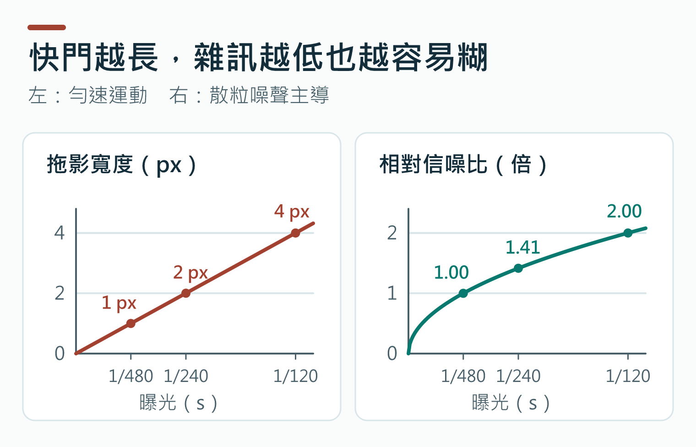
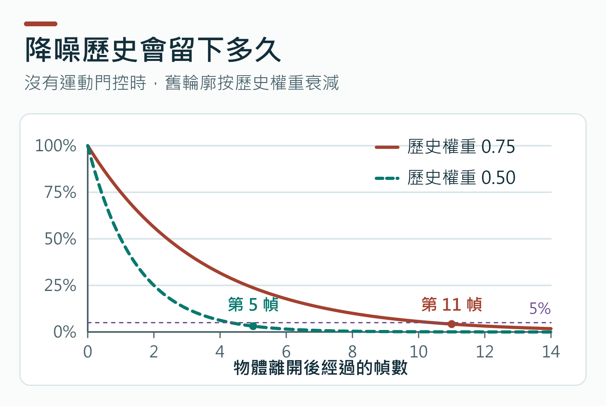
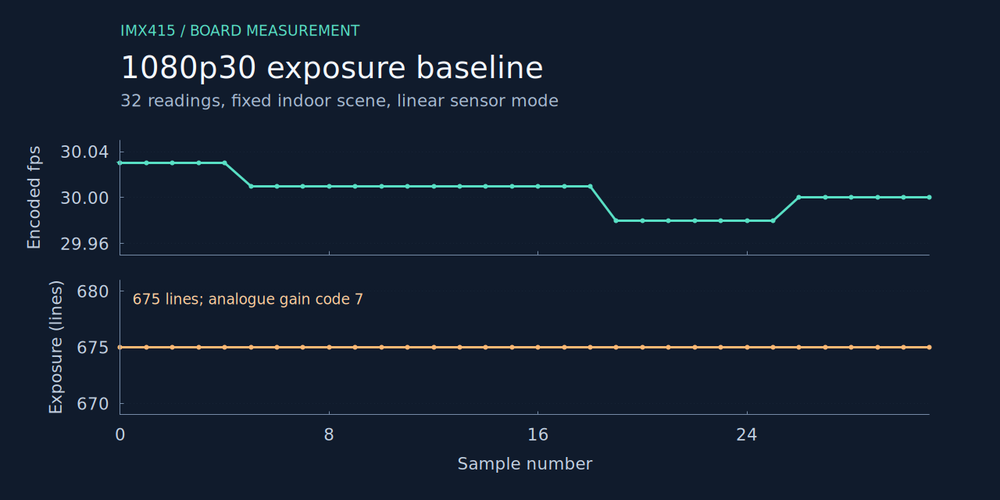

在暗處快速轉動運動相機，常能看到三種痕跡：輪廓拖寬、移動物體帶著透明重影、整條畫面忽亮忽暗。這些痕跡分別可能來自曝光積分、多曝光或時域融合，以及 AE 或照明變化。先辨認發生在哪一段，才能調對快門、HDR 或降噪。

在 **K12S-C + IMX415** 的固定室內場景，我們讀了 32 組曝光、增益與編碼幀率。這組基線用來核對目前跑的模式。接下來要用可重複的光線和運動把畫質差異量出來。

{/* truncate */}

<figure className="camera-lab-figure">
  
  <figcaption>圖 1｜曝光的取捨。假設像面速度為 480 px/s、光源恆定，信噪比以 1/480 s 為基準。曲線由公式計算。</figcaption>
</figure>

## 快門為什麼能止糊，加增益為什麼補不了光

把一個像素看成在曝光時間內累積電子的容器。照明和反射固定時，平均訊號電子數 $$N$$ 與單列曝光時間 $$T_\mathrm{exp}$$ 成正比。光子到達有統計起伏，理想 Poisson 散粒噪聲的標準差約為 $$\sqrt N$$。在簡化的獨立噪聲模型中，再加上換算到輸入電子數的讀出噪聲 $$\sigma_r$$，信噪比約為：

$$
\mathrm{SNR}\approx\frac{N}{\sqrt{N+\sigma_r^2}}
$$

散粒噪聲主導時，曝光減半使 SNR 約降低 **3 dB**；讀出噪聲主導時，同樣變更可接近 **6 dB**。真機還有暗電流、固定圖樣、量化及增益依賴。類比增益能改善後段讀出與量化相對於訊號的影響，代價可能是更早裁切。數位增益放大的是現有讀值，亮度會升高，已經收進來的光子數維持原樣。這就是運動模式需要對快門、增益和畫質取捨的原因。 [EMVA 1288 線性相機量測標準](https://www.emva.org/wp-content/uploads/EMVA1288Linear_4.0Release.pdf)

移動邊緣在列曝光期間掠過多個像素，影像等於沿這段路徑積分。均勻直線運動下，理想拖影寬度 $$L$$ 約為像面速度 $$|v_\mathrm{img}|$$ 乘曝光時間。快門可由容許的像素模糊反推：

$$
L\approx|v_\mathrm{img}|T_\mathrm{exp},
\qquad
T_\mathrm{exp}\lesssim L_\mathrm{max}/|v_\mathrm{img}|
$$

例如速度 480 px/s，在 1/120、1/240 和 1/480 s 分別約積出 **4、2、1 px** 模糊。同樣的 1/240 s，在更窄視角或更快轉動下仍可能不夠。旋轉引起的中心像面速度約為 $$f_x|\omega|$$，平移與主體本身的速度則還受距離影響。EIS 可以對齊不同時刻的影像；曝光內的拖影需靠較短快門、補光或另外的去模糊方案。 [光線和運動共同決定曝光的行動攝影研究](https://research.google/pubs/handheld-mobile-photography-in-very-low-light/)

## 3A 怎麼受到動作和照明影響

| 控制 | 常見方法 | 運動／水下要看什麼 |
| --- | --- | --- |
| AE 自動曝光 | 平均／加權測光、高光百分位、ROI、比例控制或帶滯後的控制器 | 浪面或潛燈會使平均值跳動；分開控制高光保護、增益上限、快門時間上限及變化速率 |
| AWB 自動白平衡 | 灰世界、白點、色溫範圍、場景先驗 | 水下缺紅與燈光混合會誤導估計；用可信中性區、置信度、平滑與鎖色做對照 |
| AF 自動對焦 | 反差搜尋、相位偵測、混合；固定焦模組靠鏡頭裝調 | 氣泡和顆粒會使尋焦跳到近處；先確認 VCM、相位資訊及外殼對工作距離的影響 |

運動 AE 可從陀螺與畫面運動估計模糊預算，將快門時間上限設為幀週期、感光元件時序和模糊上限三者所允許的最短值，再依亮度選類比增益、數位增益或補光。預算要設上下界與滯後，防止每次運動估計波動就改曝光。用灰卡做亮暗階躍，檢查從統計幀、決策幀到實際生效幀的相位延遲。以輸出實測過衝、恢復速度和是否增加垂直消隱、降低輸出幀率。

**燈光閃爍有獨立的時間尺度。** 某些市電驅動燈會出現 100/120 Hz 亮度調變，PWM 潛燈可能在別的頻率。等於整數個光源週期的曝光可以平均週期性變化，但 1/120 或 1/100 s 也可能超過運動模糊預算。用光電二極體或短快門測試找頻率，固定曝光掃多檔快門，再比較真直流／低閃爍補光。跨列亮暗帶表示各列可能採到不同的光源相位。整幀忽亮忽暗還須核對幀率與 AE 是否在追逐照明。

## 雙曝光 HDR 怎麼合成，又為何會有重影

感光元件的一次曝光，上限受像素滿井及 ADC 飽和控制，暗端則受噪聲底限制。HDR 讓短曝光保存浪面或燈斑，長曝光收集暗處光子。兩路 RAW 先扣黑位，再用曝光時間、增益和響應曲線轉到可比較的輻射亮度尺度。在線性且已對齊的簡化情況中，兩路融合可寫成：

$$
\hat E=
\frac{\sum_{i\in\{S,L\}} w_i(D_i-D_{0,i})/(G_iT_i)}
     {\sum_{i\in\{S,L\}} w_i}
$$

$$D_i$$ 是原始讀值，$$D_{0,i}$$ 是黑位，$$G_i$$ 是對應通道增益，$$T_i$$ 是曝光時間。權重應降低飽和、接近噪聲底或運動不一致區域的貢獻。以相同增益和飽和電平估算，兩路曝光相差 8 倍時，理想亮端可多出約 **3 檔**。可用範圍仍受重疊區信噪比、配準、幀時序與色調映射限制。HDR 曝光融合重建場景亮度範圍，色調映射再把結果放到目標顯示範圍。 [Debevec 與 Malik 的多曝光輻射亮度重建](https://people.eecs.berkeley.edu/~malik/papers/debevec-malik97.pdf)

| 方案 | 長處 | 運動場景代價 |
| --- | --- | --- |
| 單曝光 + 保高光／曲線 | 單一成像時刻，畫面時序容易控 | 暗端仍受讀出與曝光限制 |
| 感光元件交錯長短曝光（staggered／DOL 類型） | 可為每個輸出幀提供兩路曝光，兼顧暗與亮 | 兩路曝光中心有時差，移動邊緣有重影風險，需對應讀出模式和 ISP 支援 |
| 順序包圍曝光 | 適合靜態或可配準素材、測試方便 | 時隔較大，運動與照明變化更難融合 |
| 同曝光短幀連拍、對齊降噪 | 保持高光並降低暗部隨機噪聲 | 要有足夠對齊置信度、記憶體和幀數。即時預覽受等待時間限制 |
| 同次曝光雙增益讀出 | 在支援此模式的感光元件上擴展量測範圍，減少長短曝光時差 | 需確認感光元件讀出、增益拼接線性和 ISP 支援 |

在運動邊緣可對長短曝光做幾何配準與去鬼影，或在低置信區只使用較可靠的一路。統計時把**模糊寬度**與**兩個邊緣的位置差**分開量，前者受曝光時間影響，後者還受兩路取樣時間影響。 [短曝連拍與對齊融合原論文](https://research.google/pubs/burst-photography-for-high-dynamic-range-and-low-light-imaging-on-mobile-cameras/)

## 3DNR 為什麼會拖尾

空間降噪在同一幀內做平滑，例如雙邊、導引濾波或噪聲模型驅動的邊緣感知濾波。時域降噪則以過往幀的估計降低靜止區噪聲。最簡化的一階時域濾波可寫成：

$$
Y_t=(1-\alpha)X_t+\alpha Y_{t-1}
$$

靜止且各幀獨立同分布、權重固定時，穩態輸出噪聲方差是輸入噪聲方差的 $$(1-\alpha)/(1+\alpha)$$。如果上一幀留下舊輪廓，且一直沿用同一時間權重，舊輪廓會以 $$\alpha^k$$ 的比例殘留。$$\alpha=0.75$$ 的示例能把靜止標準差降至約 0.38 倍，殘影要到離開後第 11 幀才低於 5%。這是無運動門控的模型。真實 ISP 可用亮度差、運動向量、噪聲估計與遮擋置信度降低移動區的歷史權重。空間降噪可作運動區回退，限制過量銳化再把噪點拉出來。

<figure className="camera-lab-figure">
  
  <figcaption>圖 2｜歷史權重與拖尾的數值示意。30 fps 時，第 5 與第 11 幀約在 167 ms 和 367 ms。曲線未包含運動補償與遮擋門控。</figcaption>
</figure>

實際常見的三種時域路徑是**固定權重 IIR、按像素運動門控、先配準後融合**。第一種快，第二種能保動態區，第三種可在畫面運動時仍累積訊號，但要處理遮擋、相機轉動與水下顆粒。降噪應同時量噪聲、移動邊緣與細紋保留，否則塗抹細節也會得到漂亮的噪聲數字。 [對齊與時空 Wiener 融合](https://research.google/pubs/burst-photography-for-high-dynamic-range-and-low-light-imaging-on-mobile-cameras/)

## 實驗｜感光元件時序、快門、HDR、3DNR 各跑一輪

<figure className="camera-lab-figure">
  
  <figcaption>圖 3｜固定室內場景的實板量測。編碼幀率 29.98–30.03 fps，曝光回讀以驅動行數表示。</figcaption>
</figure>

實板線性模式中，RKAIQ 的 IMX415 運動 IQ 以 30 fps 為目標，曝光表配置上限 10 ms。這輪約 8 秒輪詢讀到曝光 675 行、類比增益控制值 7、垂直消隱 58，日誌為 HDR 0。要換算曝光，先讀活動模式、水平消隱與像素率。以 Linux RAW 感光元件的通用時序，行週期等於類比裁切寬度加水平消隱，再除以像素率。幀週期再乘以類比裁切高度加垂直消隱所得的總行數。核對驅動曝光控制的單位、HDR 長短路及感光元件特定偏移，並用光學事件交叉驗證。輪詢值不足以描述每幀變化或長時間掉幀。 [實板 CSV](/research/rv1126b-camera/isp-baseline.csv) · [Linux RAW 感光元件時序](https://www.kernel.org/doc/html/latest/userspace-api/media/drivers/camera-sensor.html)

| 實驗 | 固定什麼、改什麼 | 量測與判讀 |
| --- | --- | --- |
| AE 階躍和閃爍 | 灰卡與相機固定。穩定直流燈做亮暗切換，再換已知頻率的 PWM 燈 | 記錄每幀曝光、增益、亮度、幀間隔，計算過衝、達到目標亮度的時間和條紋幅度 |
| 曝光與模糊 | 用定速滑軌或轉台移動斜邊，分別拍 1/120、1/240、1/480 s。量邊緣像面速度 | 先固定增益驗證像移，另以匹配中灰亮度的增益比較暗部噪聲。比較靜止／移動邊緣的 10–90% 寬度 |
| HDR 階梯與重影 | 固定照度的灰階階梯加上移動亮邊。線性與 2-frame HDR 分開拍 | 比較亮端裁切、可辨暗階、動態邊緣雙影距離和每幀延遲。保存長短路時序與效果輸出 |
| 3DNR 時空取捨 | 鎖曝光、增益、銳化、碼率。拍灰板、斜邊、橫移細線、漂浮顆粒和潛燈掃過 | 灰板用重複幀量時間標準差。運動後量殘留長度、時間及邊緣清晰度。至少比較關、弱、強三檔 |

做同一模式的三次獨立重複，保存原片、色板、燈光、轉速、感光元件寄存器或逐幀統計，以及編碼 PTS。實際專案先驗收**線性運動 AE**，再逐項加入 HDR 與 3DNR。雙曝光是否可用仍須確認 IMX415 驅動模式、匹配的 RKAIQ IQ 及板上輸出。AF 要先確認鏡頭模組是否帶可控制 VCM，目前參考板的媒體拓撲未見該致動器。 [Rockchip RV1126B 資料手冊](https://opensource.rock-chips.com/images/8/82/Rockchip_RV1126B_Datasheet_V1.4-20250930_%28public%29.pdf)

延伸閱讀 [電子防抖與逐行讀出](/blog/rv1126b-eis-gyroflow) · [水下偏色和散射](/blog/rv1126b-underwater-color)
