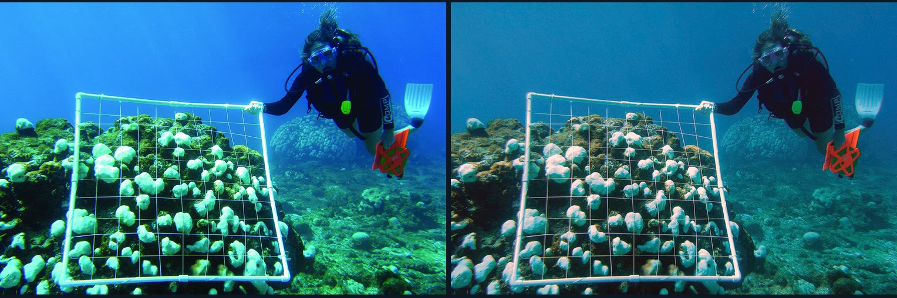

同一張水下照片，取珊瑚附近的中性色，可以把藍綠偏色拉回來。遠處的水體和近處的潛水員卻有不同的光程與照明。這個差異決定了 **MS5837 適合提供白平衡的先驗**，去散射還需要場景距離等資訊。

{/* truncate */}

<figure className="camera-lab-figure">
  
  <figcaption>左為 NOAA 原片，右為 Android 13 實機校色輸出。影像由美國 NOAA 提供。</figcaption>
</figure>

## 實驗一｜手機端中性色校正

在 OpenRadian 相簿選取一塊與主體照明相近的中性色，再導出 JPEG。這次在同一張 **960×632** 樣片的 17×17 像素區域取平均。

| 測項 | 原片 | Android 校色副本 |
| --- | ---: | ---: |
| R / G / B | 161.2 / 206.6 / 210.0 | 193.3 / 195.3 / 196.0 |
| 最高與最低通道差 | 48.8 | 2.7 |
| 解析度 | 960×632 | 960×632 |

原片 SHA-256 在導出前後一致。這次比較驗證了手機端預覽和導出流程，也顯示所選區域更接近中性。樣片沒有實地色卡與測距真值，數字只衡量選定區域的通道平衡。 [NOAA 樣片與授權](https://commons.wikimedia.org/wiki/File:NOAA_scuba_diver_surveying_bleached_corals.jpg)

## 實驗二｜同一水深，兩種光程

簡化模型以 `J × exp(-βD × d)` 表示直接光，再加上 `B∞ × (1 − exp(-βB × d))` 的背向散射。這裡相機水深固定為 5 m，保持紅通道反射與係數不變，只改相機到主體的距離 `d`。

| 主體距離 | 紅通道直接光 | 紅通道散射分量 |
| ---: | ---: | ---: |
| 0.5 m | 0.556 | 0.024 |
| 2 m | 0.382 | 0.082 |
| 5 m | 0.180 | 0.158 |

同一深度仍可得到不同的信號組成。係數為模擬假設，可用 [C++ 實驗程式](/research/rv1126b-camera/camera-lab.cpp) 和 [CSV](/research/rv1126b-camera/water-range.csv) 重跑。 [Sea-Thru 成像與距離模型](https://openaccess.thecvf.com/content_CVPR_2019/html/Akkaynak_Sea-Thru_A_Method_for_Removing_Water_From_Underwater_Images_CVPR_2019_paper.html)

## 把深度接到 RKAIQ 的順序

1. **讀壓力與溫度。** 以 TE 的 C 驅動為參考，核對實際 MS5837 型號、PROM CRC 及溫度補償。入水前量基準壓力，用 `深度 = 壓差 ÷ (水密度 × 重力加速度)` 換算。深度記錄帶時間戳和有效狀態。
2. **標定 AWB 與 CCM。** 在可重複照明下拍灰卡與色卡，調 `setMWBGain` 和 `ccm_SetAttrib`。將水深、藍水／綠水、補光狀態作為參數。節點之間插值，限制紅增益和變化速度，並提供鎖定。比較生效幀及實際編碼輸出，讓 ISP 由同一服務持有。
3. **加入局部與時序處理。** 全局 LUT 先處理整體色調。局部混光可用低解析雙邊網格預測色彩轉換，再映回全解析畫面。比較 FUnIE-GAN、Shallow-UWnet 與低解析網格迴歸。校準 INT8 時把水質、色卡、補光與暗部樣本分開覆蓋。

[TE MS5837 C 驅動](https://github.com/TEConnectivity/MS5837_Generic_C_Driver) · [FUnIE-GAN 原論文](https://arxiv.org/abs/1903.09766) · [Shallow-UWnet](https://ojs.aaai.org/index.php/AAAI/article/view/17923) · [HDRNet](https://groups.csail.mit.edu/graphics/hdrnet/data/hdrnet.pdf)

OpenRadian 目前能預覽與導出校色照片。K12S-C 尚未枚舉 MS5837，水深聯動 AWB/CCM 與水下即時視訊仍需實物驗證。水槽驗收同時記錄色卡 ΔE、紅通道噪聲、亮度或色度跳變、取景幀間隔及熱穩態。每組重複同樣的燈光、距離和色卡位置。 [UVEB 水下視訊基準](https://openaccess.thecvf.com/content/CVPR2024/html/Xie_UVEB_A_Large-scale_Benchmark_and_Baseline_Towards_Real-World_Underwater_Video_Enhancement_paper.html)

延伸閱讀 [AI-ISP 與記憶體頻寬](/blog/rv1126b-ai-isp) · [運動 ISP 的曝光與降噪](/blog/rv1126b-motion-isp)
