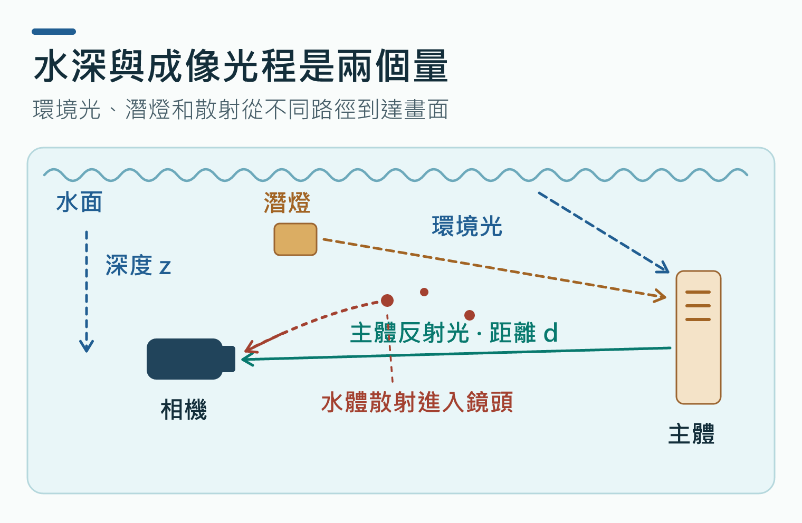
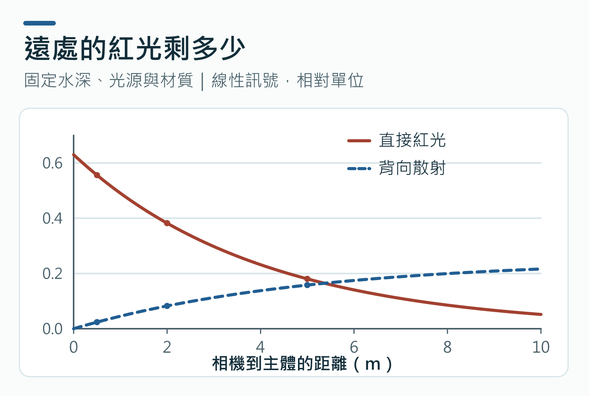

水下照片常有三種不同問題：紅色變暗，遠處像罩了層霧，潛燈一開又滿是亮點。第一種來自波長相關的衰減與光源色譜；第二種主要是水體把光散入鏡頭；第三種常是燈把鏡頭前的懸浮物照亮。同一張圖可以同時出現三種問題。

MS5837 量得到相機所在水深，這能幫助估計環境光。畫面中每個物體有各自的**相機至主體距離**，還可能受到不同的燈光照射。先把這幾段光程分開，才能決定白平衡、去散射和補光分別該做什麼。

{/* truncate */}

<figure className="camera-lab-figure">
  
  <figcaption>圖 1｜水下光路示意。壓力提供相機深度 z；光路 d、燈具位置與各點照度需要其他觀測或先驗。</figcaption>
</figure>

## 光怎麼改變｜吸收、散射、照明

在均勻水體中，單一波長的準直光束，其直接分量可用 Beer–Lambert 型衰減近似。

$$
T(\lambda,d)=e^{-c(\lambda)d},
\qquad c(\lambda)=a(\lambda)+b(\lambda)
$$

$$a$$ 是吸收係數，$$b$$ 是把原光束散出去的係數，兩者均以 m⁻¹ 表示。在不少水域，長波紅光相對藍綠衰減較快；溶解有機物、藻類和礦物懸浮物會改變整條光譜，綠水與藍水因此需要不同標定。環境照明從水面到主體也經過衰減，並受天空、水面波紋、太陽角度和水質影響。把它粗略寫成 $$E(z)\approx E(0)e^{-K_d z}$$ 時，$$K_d$$ 指向下輻照度的有效衰減係數，與準直光束的 $$c$$ 描述不同的觀測量。

若用小型潛燈照明，光在抵達主體前有一段燈到主體的距離。遠到能把燈視作點光源時，理想的表面照度還按距離平方反比和入射角餘弦變化，再乘該段水路的衰減。主體反射的光接著走另一段路到鏡頭。所以側燈位置、照射角度和物體的光譜反射率，也會改變可測到的顏色。固定相機水深時，單獨挪動燈的位置仍會造成亮度、顏色與背散射的變化。

鏡頭收到的光還包括水體送進來的散射。**前向散射**讓原本應集中在一個像素附近的物體訊號展寬，降低局部細節。**背向散射**把路徑上受照水體的光加到畫面，遠處黑物體也可能呈現青灰。開近軸燈時，強光和視線在鏡頭前重疊，近處顆粒會產生顯眼亮點。把兩盞燈移到側方、讓光束在主體附近相遇，可以減少這個重疊。近距離通常能同時減少衰減和散射。偏振法可在部分照明與水況分離散射，代價是進光量，多次曝光方案也會受相機與主體運動影響。 [Akkaynak 與 Treibitz 的修正水下成像模型](https://openaccess.thecvf.com/content_cvpr_2018/html/Akkaynak_A_Revised_Underwater_CVPR_2018_paper.html)

相機的 R、G、B 各有一段寬頻光譜，單一通道的有效衰減會受照明與物體反射影響。用線性、已扣黑位的像素值表示，簡化的通道模型可寫成下式。$$J_c$$ 是物體在當前照明下的無路徑衰減訊號，$$B_{\infty,c}$$ 是模型中的遠距背散射極限。$$\beta_c^D$$ 與 $$\beta_c^B$$ 分別描述直接分量和背散射，工程小實驗把它們設為常數。真實場景的有效係數可隨距離、反射光譜與照明變化。

$$
\begin{aligned}
I_c(d)&=J_c\,T_c(d)+B_c(d)\\
T_c(d)&=e^{-\beta_c^D d}\\
B_c(d)&=B_{\infty,c}(1-e^{-\beta_c^B d})
\end{aligned}
$$

這個模型用於理解與擬合直接光和背散射；局部強燈、顯著的前向模糊及分層水體需要更細的模型或逐區測量。 [Sea-Thru 原論文與方法](https://openaccess.thecvf.com/content_CVPR_2019/html/Akkaynak_Sea-Thru_A_Method_for_Removing_Water_From_Underwater_Images_CVPR_2019_paper.html)

## 為何加紅會紅噪，去霧又可能過頭

如果知道距離與衰減，理想反演是 $$\hat J_c=(I_c-B_c)/T_c$$。假設 $$T_c$$ 和 $$B_c$$ 已知，輸入噪聲的標準差會放大到 $$\sigma_I/T_c$$；散射估計的誤差也會被同一項放大。當紅通道只剩 5% 傳輸，除以 0.05 會放大約 20 倍的標準差。背散射取得越多，量到的灰霧不確定性也越高。實作通常設傳輸下限、限制增益，對低置信區降低復原強度，或保留遠景自然顏色。受光不足的紅通道需要補光、縮短光程或增加可用曝光來改善。

<figure className="camera-lab-figure">
  
  <figcaption>圖 2｜固定水深 5 m 的紅通道模型。橫軸是相機至主體的距離。係數用來說明相對變化，實際水域需要獨立標定。</figcaption>
</figure>

| 相機至主體 | 模型直接紅光 | 模型背散射 |
| ---: | ---: | ---: |
| 0.5 m | 0.556 | 0.024 |
| 2 m | 0.382 | 0.082 |
| 5 m | 0.180 | 0.158 |

表中的無路徑訊號為 0.63，直接衰減係數 0.25 m⁻¹，背散射極限為 0.25，背散射係數 0.20 m⁻¹。這組數值把水深和主體照明固定，只改變主體距離。[模型 CSV](/research/rv1126b-camera/water-range.csv) · [可重算的 C++ 工具](/research/rv1126b-camera/camera-lab.cpp)

## 常見方法怎麼選

| 方法 | 改變的量 | 適用品質與代價 |
| --- | --- | --- |
| 灰卡、灰世界、白點與灰邊 AWB | 調整全局 R/G/B 增益，估計一組照明色 | 灰卡可作參考。全景偏藍、珊瑚滿版或燈光混合時，全局統計容易誤判 |
| 3×3 CCM | 線性通道混色，校正感光元件與參考色域差異 | 需用對應水域、光源和色卡擬合；矩陣可放大噪聲與通道裁切 |
| 曲線、直方圖均衡／CLAHE、Retinex | 改善區域曝光、對比或照明不均 | 成本較低；容易把背散射顆粒變得更顯眼，或在高反差邊緣出現光暈 |
| 暗通道／紅通道先驗 | 從局部統計估計背景光及傳輸 | 近似適用於部分水況；紅物體、亮沙、補光燈與天空會破壞假設 |
| 測距輔助的物理反演 | 估計距離、背散射與波段衰減，再重建直接分量 | 色彩解釋較清楚；雙目／結構光要處理水下折射、匹配與濁水 |
| 全圖輕量 CNN／GAN | 學習相片到相片的顏色、對比或復原 | FUnIE-GAN、Shallow-UWnet 可作對照；失去的色彩可能由模型推測，需量跨水域泛化與幀間閃動 |
| 全局 3D LUT／局部雙邊網格 | 低解析推理色彩映射，高解析插值套用 | 全局 LUT 對相同 RGB 一視同仁；雙邊網格能分區處理，仍需防局部光暈、閃動與全幀讀寫 |

白平衡加 CCM 可以在近似線性的訊號上理解。令 $$x$$ 為扣除黑位的相機 RGB，$$g$$ 是白平衡增益，$$M$$ 是 CCM，輸出工作色域的線性 RGB 為 $$y=M\,\mathrm{diag}(g)\,x$$。先把中性補回來，再用多色塊擬合色域；增加紅增益前應查紅通道信噪比和燈照區的高光。經 JPEG、色調曲線或 YUV 編碼之後做全局調色依然實用，但強行以這些碼值套光學反演會受 Gamma、白位壓縮和已經裁切的色彩影響。低解析雙邊網格可預測每區的局部仿射係數，用原圖亮度等導引值選取係數後作用在全解析像素。 [HDRNet 雙邊學習](https://groups.csail.mit.edu/graphics/hdrnet/) · [自適應 3D LUT](https://arxiv.org/abs/2009.14468) · [FUnIE-GAN](https://arxiv.org/abs/1903.09766) · [Shallow-UWnet](https://ojs.aaai.org/index.php/AAAI/article/view/17923)

## MS5837 到 RKAIQ 要怎麼接

以水面基準 $$P_0$$ 扣除絕對壓力 $$P$$，水面下的相機深度估為 $$z=(P-P_0)/(\rho g)$$。10 kPa 壓差在密度 1,025 kg/m³ 的海水約為 1.0 m。應依 MS5837 實際型號使用對應的 PROM、CRC 和溫度補償，海水與淡水密度分開，並保留水面校零、時間戳、濾波延遲和有效旗標。確認壓力口裝配不困氣，這是攝影調色的輔助量。

在 ISP 端，先以**水域類型、深度區間、補光狀態**建立灰卡增益和色卡矩陣節點。用水深提供 AWB的初值或搜尋範圍，讓畫面中可信中性區、實際紅通道信噪比和補光狀態約束結果。節點之間平滑插值，對設定套遲滯和變化速率限制，入水和出水採不同切換條件。手動鎖色時固定當前設定。壓力讀取無效時回退到通過驗證的設定。用同一個 RKAIQ 服務持有控制權，核對 WB/CCM 是否在預覽與編碼的同一幀生效，再逐步加入局部低解析模型。 [TE MS5837 參考驅動](https://github.com/TEConnectivity/MS5837_Generic_C_Driver)

## 實驗｜把校色展示升級成水槽測量

<figure className="camera-lab-figure">
  
  <figcaption>圖 3｜NOAA 原片與 Android 13 實機匯出。這次驗證的是選定中性區和匯出流程。</figcaption>
</figure>

Android 13 上，同一張 960×632 樣片的 17×17 像素參考區，平均 RGB 從 **161.2／206.6／210.0** 變為 **193.3／195.3／196.0**，最大與最小通道差從 48.8 降到 2.7。原片 SHA-256 在匯出前後一致。這張圖缺少現場色卡、距離及照明真值，所以量到的是該區塊的中性程度。 [NOAA 樣片與授權](https://commons.wikimedia.org/wiki/File:NOAA_scuba_diver_surveying_bleached_corals.jpg)

1. **量深度和距離各自的影響。** 水槽固定相機和色卡朝向，用標尺把灰卡、彩色與黑色區塊放在不同距離。第一組讓相機深度不變，只改相機到色卡的距離。第二組讓相機和色卡一起下移、保持相距不變。記錄水質、實際距離、壓力、溫度、光源和曝光；條件相同時做三次獨立重複。將燈關、側燈和近軸燈分開做，避免把燈的近距離照度改變當作衰減。
2. **擬合與留出驗證。** 同時存 RAW 或近線性輸出和編碼影片。固定曝光與白平衡測光路，使用黑目標估計背散射，再以多段距離灰卡估計直接光衰減。以未用過的距離、水色和燈距驗證參數是否可遷移。色差 ΔE₀₀ 應比較同一白點和色彩空間下的 CIELAB 值。逐色塊報告中位數、p95、紅色與膚色區表現、暗部信噪比和高光裁切比例。 [CIEDE2000 計算及測試資料](https://hajim.rochester.edu/ece/sites/gsharma/ciede2000/)
3. **驗收影片而非單張。** 同一段潛燈掃過色卡的素材，比較基線、固定 AWB/CCM、深度輔助、局部增強。量靜止區逐幀色度變化、開關燈後穩定時間、遠近主體顏色、p95 幀間隔及熱穩態。用未見過的水域檢查學習模型，再比較 INT8 前後的暗部與色度，避免只看一個整體分數。 [UVEB 水下影片基準](https://openaccess.thecvf.com/content/CVPR2024/html/Xie_UVEB_A_Large-scale_Benchmark_and_Baseline_Towards_Real-World_Underwater_Video_Enhancement_paper.html)

K12S-C 上的 MS5837 枚舉、動態 AWB/CCM 與即時去散射仍待驗收。先取得一組深度與距離能獨立變化的水槽資料，才有依據決定要保留全局 ISP 調色，或增加局部反演與 NPU。

延伸閱讀 [AI-ISP 與記憶體頻寬](/blog/rv1126b-ai-isp) · [運動 ISP 的曝光與降噪](/blog/rv1126b-motion-isp)
