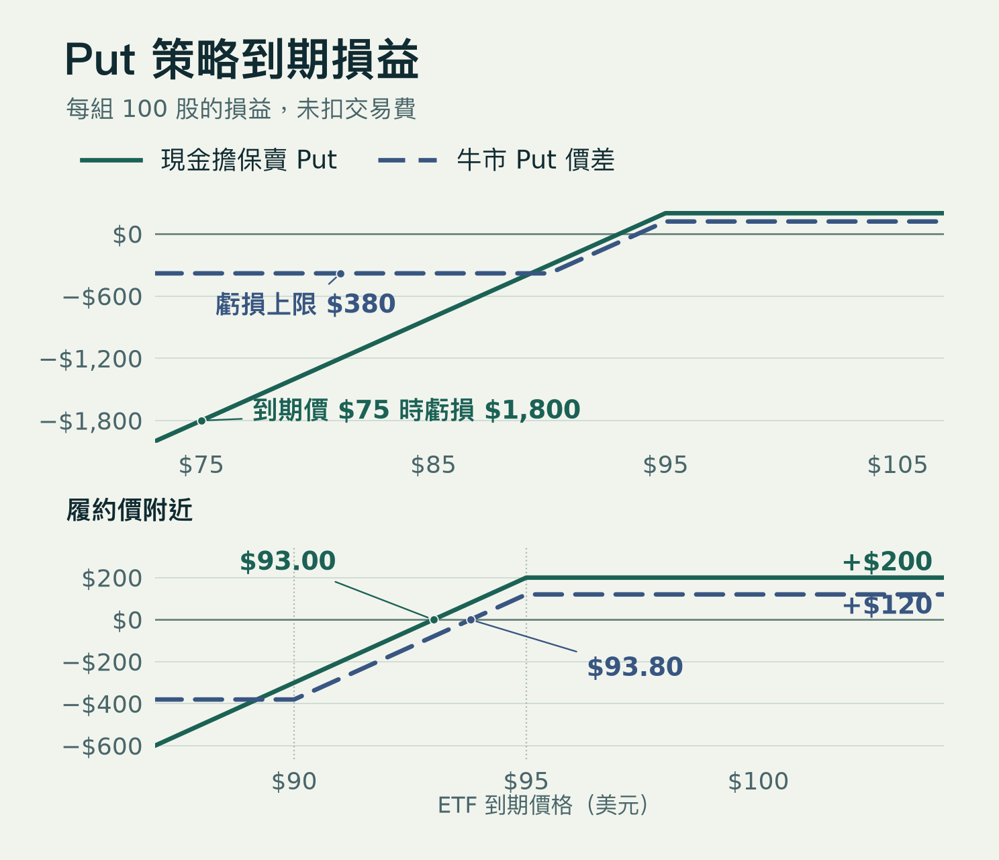

import OptionPayoffSimulator from '@site/src/components/OptionPayoffSimulator';

[量化](/quant/)

# 原子多腿期權官方資源彙總

這裡彙總了 74 條官方資料，可按平台核對組合訂單的成交規則、下單介面、費率、地區限制和結算方式。費率、帳戶地區與產品權限可能調整，請查閱適用於該帳戶的最新公告和條款。

<nav aria-label="資源分類">
  <ul>
    <li><a href="#brokers">傳統券商與交易所</a></li>
    <li><a href="#crypto-rfq">加密期權與 RFQ</a></li>
    <li><a href="#access-etfs">內地准入與港美 ETF</a></li>
    <li><a href="#put-settlement">Put 教育與結算</a></li>
    <li><a href="#strategy-simulator">期權策略損益模擬</a></li>
  </ul>
</nav>

## 傳統券商與交易所 {/* #brokers */}

### 富途香港｜美股期權組合訂單 {/* #富途香港美股期权组合订单 */}

- [富途香港｜美股期權組合訂單支援範圍](https://www.futuhk.com/hans/support/topic2_717)

### Cboe｜美國期權複雜訂單的交易機制 {/* #cboe美国期权复杂订单的交易机制 */}

- [Cboe｜美國期權複雜訂單交易機制](https://www.cboe.com/markets/us/options/trading/complex-orders)

### 富途 OpenD｜版本更新、下單介面及模擬限制 {/* #富途-opend版本更新下单接口及模拟限制 */}

- [富途 OpenD｜釋出版本與更新記錄](https://openapi.futunn.com/futu-api-doc/changelog/changelog.html)
- [富途 OpenD｜下單介面：期權組合單](https://openapi.futunn.com/futu-api-doc/trade/place-combo-order.html)
- [富途 OpenD｜交易常見問題與模擬交易限制](https://openapi.futunn.com/futu-api-doc/qa/trade.html)

### 港交所｜股票期權自訂組合 TMC {/* #港交所股票期权自订组合-tmc */}

- [港交所｜股票期權自訂組合（TMC）](https://www.hkex.com.hk/Products/Listed-Derivatives/Single-Stock/Stock-Options/Tailor_Made-Combination?sc_lang=en)

### IBKR｜成交規則、下單介面與費率 {/* #ibkr成交规则下单接口与费率 */}

- [IBKR｜保證與非保證組合訂單的差異](https://www.interactivebrokers.com/support/faq/content/difference-between-guaranteed-non-guaranteed-83243294)
- [IBKR TWS API｜下單介面](https://www.interactivebrokers.com/docs/tws-api/doc/orders/place-order)
- [IBKR｜股票期權佣金與費用](https://www.interactivebrokers.com/en/pricing/commissions-options.php)

### Alpaca｜多腿成交規則與股票期權費用 {/* #alpaca多腿成交规则与股票期权费用 */}

- [Alpaca｜三級期權交易與多腿訂單](https://docs.alpaca.markets/us/docs/options-level-3-trading)
- [Alpaca｜股票期權產品和費用](https://alpaca.markets/options)

### 微牛｜三地 API 及費率 {/* #微牛三地-api-及费率 */}

- [微牛香港｜期權交易 API](https://developer.webull.hk/apis/docs/trade-api/options/)
- [微牛新加坡｜期權交易 API](https://developer.webull.com.sg/apis/docs/trade-api/option/)
- [微牛美國｜期權交易 API](https://developer.webull.com/apis/docs/trade-api/options/)
- [微牛香港｜期權產品與費用](https://www.webull.hk/en/options)
- [微牛新加坡｜期權產品與費用](https://www.webull.com.sg/options)
- [微牛美國｜期權產品與費用](https://www.webull.com/options-trading)

### Moomoo｜OpenD 及新加坡、美國費率 {/* #moomooopend-及新加坡美国费率 */}

- [Moomoo OpenD｜期權組合下單介面](https://openapi.moomoo.com/moomoo-api-doc/en/trade/place-combo-order.html)
- [Moomoo 新加坡｜期權組合訂單](https://www.moomoo.com/sg/support/topic5_701)
- [Moomoo 新加坡｜美股期權費用](https://www.moomoo.com/sg/support/topic5_143/)
- [Moomoo 美國｜美股期權費用](https://www.moomoo.com/us/support/topic4_66/)

### 老虎與長橋｜組合格式及費率 {/* #老虎与长桥组合格式及费率 */}

- [老虎 OpenAPI｜Python SDK 組合訂單範例與欄位](https://github.com/tigerfintech/openapi-python-sdk/blob/master/tigeropen/common/util/order_utils.py)
- [老虎新加坡｜期權及相關產品費用](https://www.itiger.com/sg/commissions/fees/options_cbbcs)
- [長橋 OpenAPI｜提交多腿訂單](https://open.longbridge.com/zh-HK/docs/trade/order/submit_multileg)
- [長橋香港｜股票期權服務與費用](https://longbridge.com/hk/en/investment-products/trade-options)

### 盛寶｜多腿 API 及香港、新加坡費率 {/* #盛宝多腿-api-及香港新加坡费率 */}

- [盛寶 OpenAPI｜多腿訂單提交介面](https://developer.saxobank.com/openapi/referencedocs/trade/v2/orders/post__trade__multileg)
- [盛寶香港｜上市期權費率](https://www.home.saxo/en-hk/rates-and-conditions/listed-options/commissions)
- [盛寶新加坡｜上市期權費率](https://www.home.saxo/en-sg/rates-and-conditions/listed-options/commissions)

### Tradier｜訂單類型與費率 {/* #tradier订单类型与费率 */}

- [Tradier Brokerage API｜交易與訂單類型](https://docs.tradier.com/brokerage-api/trading)
- [Tradier｜帳戶方案與期權定價](https://tradier.com/pricing)

### tastytrade 與 Schwab｜開發者入口和費率 {/* #tastytrade-与-schwab开发者入口和费率 */}

- [tastytrade｜開發者 API 入口](https://tastytrade.com/api)
- [tastytrade｜期權與帳戶費用](https://tastytrade.com/pricing)
- [Schwab｜個人交易者 API](https://developer.schwab.com/products/trader-api--individual)
- [Schwab｜個人投資者定價指南](https://www.schwab.com/legal/schwab-pricing-guide-for-individual-investors)

### 富途香港｜逐腿計費與固定平台費 {/* #富途香港逐腿计费与固定平台费 */}

- [富途香港｜美股期權逐腿計費](https://www.futuhk.com/en/support/topic2_750)
- [富途香港｜美股期權佣金與固定平台費](https://www.futuhk.com/en/support/topic2_283)

## 加密期權與 RFQ {/* #crypto-rfq */}

### Deribit｜組合簿、API、大宗詢價與費率 {/* #deribit组合簿api大宗询价与费率 */}

- [Deribit｜組合訂單簿說明](https://support.deribit.com/hc/en-us/articles/31424954956061-Combo-Books)
- [Deribit API｜建立組合 private/create_combo](https://docs.deribit.com/api-reference/combo-books/private-create_combo)
- [Deribit｜大宗 RFQ 詢價規則](https://support.deribit.com/hc/en-us/articles/25951371614621-Deribit-Block-RFQ)
- [Deribit｜期權與組合交易費用](https://support.deribit.com/hc/en-us/articles/25944746248989-Fees)

### Thalex｜原子撮合、RFQ、API 與費率 {/* #thalex原子撮合rfqapi-与费率 */}

- [Thalex｜組合訂單及原子撮合規則](https://thalex.com/trading-information/combination-orders)
- [Thalex｜RFQ 報價規則](https://thalex.com/trading-information/rfqs)
- [Thalex｜開發者 API 文件](https://thalex.com/docs/)
- [Thalex｜交易費率](https://thalex.com/trading-information/fees)

### OKX 與 Bybit｜RFQ 介面、費率及地區 {/* #okx-与-bybitrfq-接口费率及地区 */}

- [OKX｜大宗交易與 RFQ 介面](https://www.okx.com/docs-v5/en/#block-trading)
- [OKX｜交易費率](https://www.okx.com/fees)
- [OKX 新加坡｜風險與合規披露](https://www.okx.com/en-sg/help/risk-compliance-disclosure)
- [Bybit API｜建立 RFQ](https://bybit-exchange.github.io/docs/v5/rfq/trade/create-rfq)
- [Bybit｜期權費率說明](https://www.bybit.com/en/help-center/article/Bybit-Option-Fees-Explained)
- [Bybit｜RFQ 費率下限規則](https://www.bybit.com/en/help-center/article/Floor-Rule-for-RFQ-Fee-Rates)
- [Bybit｜限制服務的國家和地區](https://www.bybit.com/en/help-center/article/Service-Restricted-Countries)

### Binance 與 Coinbase｜多腿產品及費率說明 {/* #binance-与-coinbase多腿产品及费率说明 */}

- [Binance｜多腿期權產品說明](https://www.binance.com/en/support/faq/detail/436b04e46b2248bead0619f5b6e01f6d)
- [Binance｜期權交易費率](https://www.binance.com/en/support/faq/detail/5326e5de61c34fed98abe28d2f175a23)
- [Binance｜期權 RFQ 產品與規則](https://www.binance.com/en/support/faq/detail/6d3a80c6574f482eb45457eac64bbff6)
- [Coinbase｜全球衍生品期權組合訂單](https://help.coinbase.com/en/coinbase/derivatives/global-derivatives-options-combo-order)

## 內地准入與港美 ETF {/* #access-etfs */}

### 中國證監會及外匯局｜跨境整治、涉事機構與個人購匯 {/* #中国证监会及外汇局跨境整治涉事机构与个人购汇 */}

- [中國證監會｜跨境證券業務整治相關公告](https://www.csrc.gov.cn/csrc/c100028/c7634328/content.shtml)
- [中國證監會｜相關機構及通報](https://www.csrc.gov.cn/csrc/c100028/c7634330/content.shtml)
- [國家外匯管理局｜個人購匯申請書（PDF）](https://www.safe.gov.cn/safe/file/file/20210402/30fab7a9646f417ca9d2f67ff4c1e5f0.pdf)

### IBKR 與 Tradier｜可接受申請地區 {/* #ibkr-与-tradier可接受申请地区 */}

- [IBKR｜可開立帳戶的國家和地區](https://portal.interactivebrokers.com/en/accounts/open-account-country-list.php)
- [Tradier｜可申請與受限的國家和地區](https://support.tradier.com/kb/guide/en/permitted-and-blocked-countries-CLzSa0D1rf/Steps/4997916)

### 港交所、發行人及 Nasdaq｜南向資格、3042 上市資料、IBIT 費率及期權 {/* #港交所发行人及-nasdaq南向资格3042-上市资料ibit-费率及期权 */}

- [港交所｜ETF 產品資料與資格說明](https://www.hkex.com.hk/News/News-Centre/Equity-Market-Pulse/Product-Spotlight?sc_lang=en)
- [港交所｜3042 上市資料通告（PDF）](https://www.hkex.com.hk/-/media/HKEX-Market/Services/Circulars-and-Notices/Participant-and-Members-Circulars/SEHK/2024/ce_SEHK_CT_053_2024_1.pdf)
- [iShares｜IBIT 產品資料與費率](https://www.ishares.com/us/products/333011/ishares-bitcoin-trust-etf-ibit)
- [Nasdaq｜IBIT 期權上市說明](https://www.nasdaq.com/newsroom/nasdaq-listed-ibit-options-end-first-day-top-1-all-options-products-traded)

### IBKR｜香港和新加坡的數字資產 ETP 權限 {/* #ibkr香港和新加坡的数字资产-etp-权限 */}

- [IBKR 香港｜數字資產 ETP 交易權限公告](https://www.interactivebrokers.com.hk/en/general/about/mediaRelations/5-1-24.php)
- [IBKR 新加坡｜現貨比特幣 ETP 交易權限](https://www.interactivebrokers.com.sg/en/trading/spot-bitcoin-etps.php)

### 監管文件及平台地區條款 {/* #监管文件及平台地区条款 */}

- [中國證監會｜跨境證券相關監管文件](https://www.csrc.gov.cn/csrc/c100028/c7614318/content.shtml)
- [香港證監會｜虛擬資產交易平台不違反期結束的聲明](https://www.sfc.hk/en/News-and-announcements/Policy-statements-and-announcements/SFC-statement-on-the-end-of-non-contravention-period-for-virtual-asset-trading-platforms)
- [Deribit｜限制司法轄區](https://support.deribit.com/hc/en-us/articles/25944487427741-Restricted-Jurisdictions)
- [Thalex｜排除的司法轄區](https://thalex.com/trading-information/legal/excluded-jurisdictions)

## Put 教育與結算 {/* #put-settlement */}

- [OIC｜現金擔保賣 Put](https://www.optionseducation.org/strategies/all-strategies/cash-secured-put)
- [OIC｜牛市 Put 價差](https://www.optionseducation.org/strategies/all-strategies/bull-put-spread-credit-put-spread)
- [OIC｜期權指派常見問題](https://www.optionseducation.org/referencelibrary/faq/options-assignment)
- [Deribit｜反向期權合約規格和結算](https://support.deribit.com/hc/en-us/articles/31424939096093-Inverse-Options)

### 到期損益示意 {/* #到期盈亏示意 */}

下圖使用假設標的和權利金。兩種組合均按同一到期日、每張 100 股計算，金額單位為美元，交易費另計。

- **現金擔保賣 Put**。賣出一張履約價 95 的 Put，每股收取 2.00。到期損益平衡價為 93，最大收益為 200，標的跌至零時虧損為 9,300。
- **牛市 Put 價差**。賣出一張履約價 95 的 Put，再買入一張履約價 90 的 Put，每股淨收 1.20。到期損益平衡價為 93.80，最大收益為 120，兩腿均如預期履約或結算時的最大到期虧損為 380。

<figure style={{marginInline: 0}}>
  
  <figcaption>橫軸為 ETF 到期價格，縱軸為每組 100 股的到期損益。實線為現金擔保賣 Put，虛線為牛市 Put 價差。</figcaption>
</figure>

<OptionPayoffSimulator />

