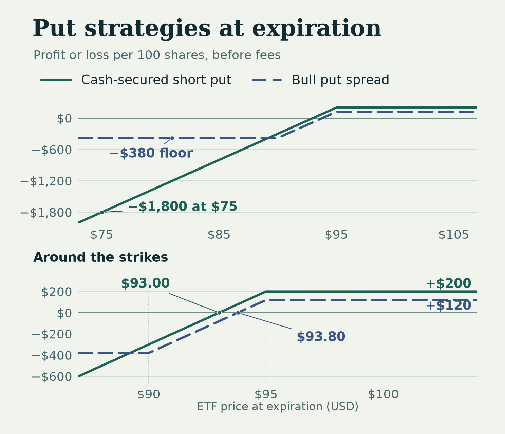

# 原子多腿期权官方资源汇总

这里汇总了 74 条官方资料，可按平台核对组合订单的成交规则、下单接口、费率、地区限制和结算方式。费率、账户地区与产品权限可能调整，以适用于目标账户的最新公告和条款为准。

<nav aria-label="资源分类">
  <ul>
    <li><a href="#brokers">传统券商与交易所</a></li>
    <li><a href="#crypto-rfq">加密期权与 RFQ</a></li>
    <li><a href="#access-etfs">内地准入与港美 ETF</a></li>
    <li><a href="#put-settlement">Put 教育与结算</a></li>
  </ul>
</nav>

## 传统券商与交易所 {/* #brokers */}

### 富途香港｜美股期权组合订单

- [富途香港｜美股期权组合订单支持范围](https://www.futuhk.com/hans/support/topic2_717)

### Cboe｜美国期权复杂订单的交易机制

- [Cboe｜美国期权复杂订单交易机制](https://www.cboe.com/markets/us/options/trading/complex-orders)

### 富途 OpenD｜版本更新、下单接口及模拟限制

- [富途 OpenD｜发布版本与更新记录](https://openapi.futunn.com/futu-api-doc/changelog/changelog.html)
- [富途 OpenD｜下单接口：期权组合单](https://openapi.futunn.com/futu-api-doc/trade/place-combo-order.html)
- [富途 OpenD｜交易常见问题与模拟交易限制](https://openapi.futunn.com/futu-api-doc/qa/trade.html)

### 港交所｜股票期权自订组合 TMC

- [港交所｜股票期权自订组合（TMC）](https://www.hkex.com.hk/Products/Listed-Derivatives/Single-Stock/Stock-Options/Tailor_Made-Combination?sc_lang=en)

### IBKR｜成交规则、下单接口与费率

- [IBKR｜保证与非保证组合订单的区别](https://www.interactivebrokers.com/support/faq/content/difference-between-guaranteed-non-guaranteed-83243294)
- [IBKR TWS API｜下单接口](https://www.interactivebrokers.com/docs/tws-api/doc/orders/place-order)
- [IBKR｜股票期权佣金与费用](https://www.interactivebrokers.com/en/pricing/commissions-options.php)

### Alpaca｜多腿成交规则与股票期权费用

- [Alpaca｜三级期权交易与多腿订单](https://docs.alpaca.markets/us/docs/options-level-3-trading)
- [Alpaca｜股票期权产品和费用](https://alpaca.markets/options)

### 微牛｜三地 API 及费率

- [微牛香港｜期权交易 API](https://developer.webull.hk/apis/docs/trade-api/options/)
- [微牛新加坡｜期权交易 API](https://developer.webull.com.sg/apis/docs/trade-api/option/)
- [微牛美国｜期权交易 API](https://developer.webull.com/apis/docs/trade-api/options/)
- [微牛香港｜期权产品与费用](https://www.webull.hk/en/options)
- [微牛新加坡｜期权产品与费用](https://www.webull.com.sg/options)
- [微牛美国｜期权产品与费用](https://www.webull.com/options-trading)

### Moomoo｜OpenD 及新加坡、美国费率

- [Moomoo OpenD｜期权组合下单接口](https://openapi.moomoo.com/moomoo-api-doc/en/trade/place-combo-order.html)
- [Moomoo 新加坡｜期权组合订单](https://www.moomoo.com/sg/support/topic5_701)
- [Moomoo 新加坡｜美股期权费用](https://www.moomoo.com/sg/support/topic5_143/)
- [Moomoo 美国｜美股期权费用](https://www.moomoo.com/us/support/topic4_66/)

### 老虎与长桥｜组合格式及费率

- [老虎 OpenAPI｜Python SDK 组合订单示例与字段](https://github.com/tigerfintech/openapi-python-sdk/blob/master/tigeropen/common/util/order_utils.py)
- [老虎新加坡｜期权及相关产品费用](https://www.itiger.com/sg/commissions/fees/options_cbbcs)
- [长桥 OpenAPI｜提交多腿订单](https://open.longbridge.com/zh-HK/docs/trade/order/submit_multileg)
- [长桥香港｜股票期权服务与费用](https://longbridge.com/hk/en/investment-products/trade-options)

### 盛宝｜多腿 API 及香港、新加坡费率

- [盛宝 OpenAPI｜多腿订单提交接口](https://developer.saxobank.com/openapi/referencedocs/trade/v2/orders/post__trade__multileg)
- [盛宝香港｜上市期权费率](https://www.home.saxo/en-hk/rates-and-conditions/listed-options/commissions)
- [盛宝新加坡｜上市期权费率](https://www.home.saxo/en-sg/rates-and-conditions/listed-options/commissions)

### Tradier｜订单类型与费率

- [Tradier Brokerage API｜交易与订单类型](https://docs.tradier.com/brokerage-api/trading)
- [Tradier｜账户方案与期权定价](https://tradier.com/pricing)

### tastytrade 与 Schwab｜开发者入口和费率

- [tastytrade｜开发者 API 入口](https://tastytrade.com/api)
- [tastytrade｜期权与账户费用](https://tastytrade.com/pricing)
- [Schwab｜个人交易者 API](https://developer.schwab.com/products/trader-api--individual)
- [Schwab｜个人投资者定价指南](https://www.schwab.com/legal/schwab-pricing-guide-for-individual-investors)

### 富途香港｜逐腿计费与固定平台费

- [富途香港｜美股期权逐腿计费](https://www.futuhk.com/en/support/topic2_750)
- [富途香港｜美股期权佣金与固定平台费](https://www.futuhk.com/en/support/topic2_283)

## 加密期权与 RFQ {/* #crypto-rfq */}

### Deribit｜组合簿、API、大宗询价与费率

- [Deribit｜组合订单簿说明](https://support.deribit.com/hc/en-us/articles/31424954956061-Combo-Books)
- [Deribit API｜创建组合 private/create_combo](https://docs.deribit.com/api-reference/combo-books/private-create_combo)
- [Deribit｜大宗 RFQ 询价规则](https://support.deribit.com/hc/en-us/articles/25951371614621-Deribit-Block-RFQ)
- [Deribit｜期权与组合交易费用](https://support.deribit.com/hc/en-us/articles/25944746248989-Fees)

### Thalex｜原子撮合、RFQ、API 与费率

- [Thalex｜组合订单及原子撮合规则](https://thalex.com/trading-information/combination-orders)
- [Thalex｜RFQ 报价规则](https://thalex.com/trading-information/rfqs)
- [Thalex｜开发者 API 文档](https://thalex.com/docs/)
- [Thalex｜交易费率](https://thalex.com/trading-information/fees)

### OKX 与 Bybit｜RFQ 接口、费率及地区

- [OKX｜大宗交易与 RFQ 接口](https://www.okx.com/docs-v5/en/#block-trading)
- [OKX｜交易费率](https://www.okx.com/fees)
- [OKX 新加坡｜风险与合规披露](https://www.okx.com/en-sg/help/risk-compliance-disclosure)
- [Bybit API｜创建 RFQ](https://bybit-exchange.github.io/docs/v5/rfq/trade/create-rfq)
- [Bybit｜期权费率说明](https://www.bybit.com/en/help-center/article/Bybit-Option-Fees-Explained)
- [Bybit｜RFQ 费率下限规则](https://www.bybit.com/en/help-center/article/Floor-Rule-for-RFQ-Fee-Rates)
- [Bybit｜限制服务的国家和地区](https://www.bybit.com/en/help-center/article/Service-Restricted-Countries)

### Binance 与 Coinbase｜多腿产品及费率说明

- [Binance｜多腿期权产品说明](https://www.binance.com/en/support/faq/detail/436b04e46b2248bead0619f5b6e01f6d)
- [Binance｜期权交易费率](https://www.binance.com/en/support/faq/detail/5326e5de61c34fed98abe28d2f175a23)
- [Binance｜期权 RFQ 产品与规则](https://www.binance.com/en/support/faq/detail/6d3a80c6574f482eb45457eac64bbff6)
- [Coinbase｜全球衍生品期权组合订单](https://help.coinbase.com/en/coinbase/derivatives/global-derivatives-options-combo-order)

## 内地准入与港美 ETF {/* #access-etfs */}

### 中国证监会及外汇局｜跨境整治、涉事机构与个人购汇

- [中国证监会｜跨境证券业务整治相关公告](https://www.csrc.gov.cn/csrc/c100028/c7634328/content.shtml)
- [中国证监会｜相关机构及通报](https://www.csrc.gov.cn/csrc/c100028/c7634330/content.shtml)
- [国家外汇管理局｜个人购汇申请书（PDF）](https://www.safe.gov.cn/safe/file/file/20210402/30fab7a9646f417ca9d2f67ff4c1e5f0.pdf)

### IBKR 与 Tradier｜可接受申请地区

- [IBKR｜可开立账户的国家和地区](https://portal.interactivebrokers.com/en/accounts/open-account-country-list.php)
- [Tradier｜可申请与受限的国家和地区](https://support.tradier.com/kb/guide/en/permitted-and-blocked-countries-CLzSa0D1rf/Steps/4997916)

### 港交所、发行人及 Nasdaq｜南向资格、3042 上市资料、IBIT 费率及期权

- [港交所｜ETF 产品资料与资格说明](https://www.hkex.com.hk/News/News-Centre/Equity-Market-Pulse/Product-Spotlight?sc_lang=en)
- [港交所｜3042 上市资料通告（PDF）](https://www.hkex.com.hk/-/media/HKEX-Market/Services/Circulars-and-Notices/Participant-and-Members-Circulars/SEHK/2024/ce_SEHK_CT_053_2024_1.pdf)
- [iShares｜IBIT 产品资料与费率](https://www.ishares.com/us/products/333011/ishares-bitcoin-trust-etf-ibit)
- [Nasdaq｜IBIT 期权上市说明](https://www.nasdaq.com/newsroom/nasdaq-listed-ibit-options-end-first-day-top-1-all-options-products-traded)

### IBKR｜香港和新加坡的数字资产 ETP 权限

- [IBKR 香港｜数字资产 ETP 交易权限公告](https://www.interactivebrokers.com.hk/en/general/about/mediaRelations/5-1-24.php)
- [IBKR 新加坡｜现货比特币 ETP 交易权限](https://www.interactivebrokers.com.sg/en/trading/spot-bitcoin-etps.php)

### 监管文件及平台地区条款

- [中国证监会｜跨境证券相关监管文件](https://www.csrc.gov.cn/csrc/c100028/c7614318/content.shtml)
- [香港证监会｜虚拟资产交易平台不违反期结束声明](https://www.sfc.hk/en/News-and-announcements/Policy-statements-and-announcements/SFC-statement-on-the-end-of-non-contravention-period-for-virtual-asset-trading-platforms)
- [Deribit｜限制司法辖区](https://support.deribit.com/hc/en-us/articles/25944487427741-Restricted-Jurisdictions)
- [Thalex｜排除的司法辖区](https://thalex.com/trading-information/legal/excluded-jurisdictions)

## Put 教育与结算 {/* #put-settlement */}

- [OIC｜现金担保卖 Put](https://www.optionseducation.org/strategies/all-strategies/cash-secured-put)
- [OIC｜牛市 Put 价差](https://www.optionseducation.org/strategies/all-strategies/bull-put-spread-credit-put-spread)
- [OIC｜期权指派常见问题](https://www.optionseducation.org/referencelibrary/faq/options-assignment)
- [Deribit｜反向期权合约规格和结算](https://support.deribit.com/hc/en-us/articles/31424939096093-Inverse-Options)

### 到期盈亏示意

下图使用假设标的和权利金。两种组合均按同一到期日、每张 100 股计算，金额单位为美元，交易费另计。

- **现金担保卖 Put**。卖出一张行权价 95 的 Put，每股收取 2.00。到期盈亏平衡价为 93，最大收益为 200，标的跌至零时亏损为 9,300。
- **牛市 Put 价差**。卖出一张行权价 95 的 Put，再买入一张行权价 90 的 Put，每股净收 1.20。到期盈亏平衡价为 93.80，最大收益为 120，两腿均如预期行权或结算时的最大到期亏损为 380。

<figure style={{marginInline: 0}}>
  
  <figcaption>横轴为 ETF 到期价格，纵轴为每组 100 股的到期盈亏。实线为现金担保卖 Put，虚线为牛市 Put 价差。</figcaption>
</figure>

